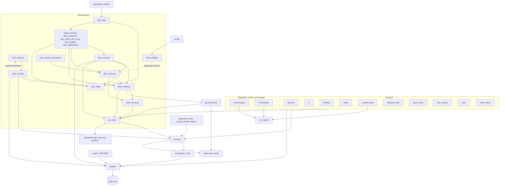

# Drover rearchitecture: design

Read at `H:\repos\drover.worktrees\cleanup-stage4`, branch `fix/cleanup-stage4`, HEAD 92ce946. Line numbers are at that commit.
Status: final for building and for the owner's approval, revised after three adversarial reviews and the builder check, with rulings 1 to 14 folded in. Nothing here has been built. Fresh Claude subagents build and review it; Drover's dispatch does not.
Tags: **[M]** measured or read directly; **[I]** inferred.
Labels: "ruling N" is one of the session lead's calls (section 18, Appendix B). R1 to R9 are guard rules in `tests/test_seams.py` (section 13). B, M and S are first-review findings, 2B, 2M and 2S the second review's, 3M the third review's; Q, D and G are the builder questions, the review's depth notes and its glossary notes. Each has a row in Appendix A.

## 1. Summary

The verdict was that the features are sound but the shared machinery has no owner. This design gives that machinery owners:

| Module | Answers | Candidate |
|---|---|---|
| `drover/process.py` | Run one short-lived command and say how it ended | 1 |
| `drover/git_client.py` | Ask git a question: yes, no or unknown | 2 |
| `drover/git_worktrees.py` | What did git list this stage, and has any of it moved? | live problem |
| `drover/durable.py` | Publish, move and remove files, outlasting a reader | 3 |
| `drover/disk_stage.py`, with `disk_side.py` and `disk_runtime.py` | Run one cleanup stage, own its time, keep its rows | 4 |
| `drover/disk_evidence.py`, `disk_authority.py`, `disk_removal.py` | What is known, may it go, take it away | 5 |
| `drover/run_output.py` | A run's output record, as a record and codec | 6 |

**Scope.** This is the session lead's call:
- Full design: candidates 1 process running, 2 git with a three-valued outcome, 3 atomic files, 4 cleanup stage run, 5 cleanup authority by concept, 6 run output record.
- Candidate 7, dispatcher mixins: no redesign, only the seam where others touch it (section 12).

**Out of scope:**
- Old-ledger-module removal (B-2b).
- Ledger upward imports.
- The two spec defects awaiting owner rulings: 500 GB does not hold Windows work, and the idle waiver at hold or critical. The waiver moves verbatim and is not changed.

**Open for the owner:** the import allowlist decision (section 16, O1). What only the owner runs is in section 19.

**What changed on reading the code.** Candidate 6 shrank from a module to a record and codec. Candidate 4 needs no streaming thread. Two thin-module folds were dropped. The live listing problem became its own module and comes first, because it blocks apply today and it can use today's `placement.git` until slice 4. Section 3 lists where the review was wrong.

## 2. The live problem: worktree listing

### 2.1 What was measured

All on 2026-11-02, WSL load 17 to 47, read-only. Times are one run each unless shown as a range [M].

| Measurement | drover (45 admin dirs) | PanGloss (48) | motif (210) |
|---|---|---|---|
| WSL `git worktree list --porcelain -z` on /mnt/h | 14.2, 46.2, 71.1, 76.7 s | not rerun; 97.3 s in the brief | 65.5 s; 265.9 s in the brief |
| Native Windows git, same repo | 0.11, 0.15 s | not run | 0.35 s |
| WSL, direct read of `gitdir`, `HEAD`, `locked`, one thread | 7.1 s | 8.2 s | 30.6 s |
| WSL, same read, 8 threads | 0.84 s | 1.0 s | 5.4 s |
| WSL, `gitdir` only, one thread | 1.8 s | 2.4 s | 23.4 s |
| WSL, `scandir` of `.git/worktrees` | 0.026 s | 0.034 s | 0.011 s |
| Windows Python, same three-file read | 0.010 s | 0.010 s | 0.070 s |

Other facts [M]:
- A traced drover listing made 2,035 traced syscalls in 22.8 s, including 1,009 `newfstatat`, or about 45 per worktree. `strace -c` counts 2,307 calls and only 1.3 s of system time.
- `/mnt/h` is 9p (`aname=drvfs`, `cache=0x5`).
- `packed-refs` is 11 KB, so ref size is not the cause.
- Nine repos under `/mnt/h/repos` hold 401 admin directories, and `machine` has 81. I did not read `.drover`, so which of these are registered is not established here.

### 2.2 Why it is slow

**The answer:** git makes roughly 2,000 file operations on drover, and each is a 9p round trip to Windows. Under load one takes about 7 to 35 ms on average, up to 160 ms. The time is spent waiting, not computing. Eight threads gave a five- to eightfold gain, so the wait is per operation rather than a single queue [M]. That native git takes 0.15 s on the same files settles where the cost is [M].

**Inferred:**
- The exact breakdown of git's operations [I]. The trace shows 29 opens of `packed-refs`, per-worktree `locked` stats and path walks.
- My own probe ran with its working directory on `/mnt/c`, which accounts for the 93 stats of `/mnt/c/Users/johnm`; that is an artefact, not a finding [I].
- What drives the 9p latency itself is not isolated. Defender, the Windows 9p server and load are all possible [I].

### 2.3 How many listings cleanup makes

The brief says `entries(repo)` is called twice per removal. It is worse. `overlaps_worktrees` with no `registered=` lists **every** repo in the request (disk_worktrees.py:494-495), and it is called that way at disk_paths.py:304 and disk_worktrees.py:346. [M]

| Where | Listings |
|---|---|
| Stage 4 first pass, disk_worktrees.py:247 | R, one per repo |
| Stage 5 first pass, disk_paths.py:356 then :361 | 2R: all repos, then each again |
| Stage 6, disk_paths.py:446 | R |
| One worktree removal, disk_worktrees.py:312, :333, :346 | 2 + R |
| One disposable removal, disk_paths.py:290, :302, :304 | 2 + R |
| One registration repair, disk_registrations.py:272 | 1 |

R is the number of configured repos. For drover, PanGloss and motif alone, one removal at the brief's timings costs at least 450 s. A pass over stages 4 to 6 lists each repo about four times, per drive and per side, which is a large part of the 2h19m [I].

### 2.4 Design decisions

- **Real listing stays the authority (ruling 13).** `git worktree list --porcelain -z` runs once per repo per stage run, across all configured repos, on `LISTING_TIMEOUT_S`, 400 s: 1.5 times the worst measured, motif's 265.9 s. Today's 60 s is what blocks apply. Any failure leaves that repo wholly unknown, as today: nothing in it removed, no stamp.
- **A file reader is never the authority.** `git_worktrees` reads admin files only for the fresh proof at a removal, in-process on 8 threads, and compares them with that stage's listing. It can only refuse. It earns its place by cost: 12 to 90 times faster than git on WSL (drover 0.84 s against 14 to 77 s, motif 5.4 s against 66 s), so a proof per removal is affordable. It cannot replace the listing, because files do not show every way git refuses: all three blockers of the second review were that gap.
- **Removal-time evidence stays at least as strong as today (ruling 1).** The proof is a new read of every repo, made after the evidence, with the target's resolved HEAD through one `rev-parse`. The listing row is only what it is compared with, and the listing is older than all the evidence, so a change at any time since is seen. Section 7.1 makes the proof a constructor rule, checked by guard R7, because no type checker runs on this repo [M].
- **Rejected, because each would weaken the fresh check:**
  - Letting the reader select, or stand in for a repo's listing (ruling 13).
  - Using the stage listing at removal with no fresh read.
  - Reusing one read across the removal units of a worktree.
  - An mtime shortcut on `.git/worktrees`. It misses a pointer rewritten in place by `git worktree move` or `repair`.
  - `scandir` name comparison, for the same reason.
- **Rejected, for correctness:** listing with Windows git.
  - ADR-0007 says inspection runs on the owning side.
  - Windows git resolves ext4 pointers such as `../../../../../../../home/...` against the wrong root.
  - A WSL cleanup worker cannot rely on Windows interop anyway (disk_runtime.py:61-64).
- **Read timeouts come from the stage's clock,** not a fixed figure: the listing takes `clock.patience(LISTING_TIMEOUT_S)` from slice 5, and other reads `clock.patience(cap)` from slice 6a. Until then the listing keeps its 400 s and evidence commands their 60 s. Mutating git steps never use it: they take a fixed cap (ruling 4, section 6.1). A timeout is unknown, and unknown keeps.
- **One decision stays with the owner.** Today any repo error voids apply authority (disk_cleanup.py:318). It is left as it is (O2).

### 2.5 Expected cost after the change [I]

**A stage's listings.** A WSL stage run lists each repo once, in turn, at the times of section 2.1. Windows stage runs take under a second.

| Repos configured | One stage run, best to worst measured | Share of the 1,440 s line |
|---|---|---|
| drover, PanGloss, motif | 177 s to 440 s (14.2 + 97.3 + 65.5; 76.7 + 97.3 + 265.9) | 12% to 31% |
| All 401 admin directories, which is not established | 125 s to 800 s, at 0.31 to 2.0 s per directory [I] | 9% to 56% |

So stages 4, 5 and 6 cost three times that per drive on the WSL side, against about four times today plus 2 + R per removal, and `daily` mode, which stops at stage 4, costs it once. This is the price of ruling 13, and it is not small: a listing is still the slowest single step of a stage. PanGloss has one measurement only.

**A removal's fresh proof.**
- One read of every repo's `gitdir`, `locked` and `commondir`. That is three files per admin directory, so the 8-thread three-file figures apply: 0.84 + 1.0 + 5.4 = 7.2 s for the three repos, every removal, wherever its target is. There is no second read: the listing does the "before" read's work. If all 401 directories are configured, about 9.5 s.
- One `rev-parse` of the target's tip, on top of about 7 git spawns already there (`status`, `rev-parse HEAD`, three in `repos.load`, `ls-files`, one more). That is about 8 spawns at 0.2 to 0.7 s each, 1.6 to 5.6 s. A detached target saves the `rev-parse`. The common directory is one more spawn per repo per stage, not per removal.

So one removal takes about 9 to 13 s, or 11 to 15 s with every repo configured, against 450 s or more today. These leave out the process proof and the delete itself, as the earlier 8 to 21 s did. A stage's 1,440 s, less its listings, then covers about 75 to 140 removal units for the three repos, and about 40 to 120 with all 401; a stage that runs out says so and leaves the rest. This is an estimate from the table above, at that load, not a measurement. Slice 1 takes a read-only timing on `/mnt/h`. Slice 8 is the conditional step if the proof's read proves too slow.

## 3. Where the review and brief were wrong or out of date

1. **Removal listings** are 2 + R per removal, not 2 (section 2.3).
2. **HEAD differs from the review's pin (e226b68).** 12 sites lack the console flag and 5 are reachable on Windows (not 13 and 6). 39 hand-spread `NO_WINDOW` arguments (not 38). "37 raw sites in 23 modules" holds only excluding `scripts/`; with it, 43 in 25 [M]. 51 modules in `drover/` and `hub/` import `subprocess`, and 28 of them only for exception types or an injected default; the review did not state this, and it sizes the guard's exception list [M].
3. **Defect 1 does not map to candidate 1.** The argv file at launch.py:366 is the detached runner's route, on the ADR-0002 side. `process.py` does not absorb it. "Payload limits stop reaching callers" is true only for short-lived commands.
4. **`_temp_deadline` is not a copy of the deadline.** It is a per-root scan budget, a nested concept that stays. The real gaps are others:
   - Stages 2, 3 and 6 have no stage deadline at all.
   - `disk_budget.deadline` starts after the process proof, not at worker start, so the 20% margin (360 s) is partly spent before the clock begins (disk_side.py:15 runs before :16).
   - A single removal at 2 + R listings can overrun that margin and lose every row.
5. **"`cleanup_call` loses 150 lines" is overstated.** About 90 of its 153 lines are the termination proof, which is safety work and stays. It gets clearer, not much shorter.
6. **Streaming needs no reader thread.** `subprocess.run` already keeps partial output on timeout, and disk_runtime.py:106 already reads it. The defect is that the worker writes nothing until the end.
7. **"Fold `disk_preflight` back" would grow the allowlist.** `config` may not import any `drover.disk*`. The edge can only be removed or left, and renaming it does nothing. It has three importers, not one concern to fold. Dropped.
8. **`disk_schedule` and `disk_schedule_steps` fold** is real but unrelated to any defect. Dropped for proportion.
9. **"Removes `compaction_hold` from three leaves"** moves the edge to `process.py`. It cuts the knot only if `compaction_hold` loses its deferred edges. `durable` removes the `disk_state` edge; the `config` edge stays (O6).
10. **The replace count is 15, not 12.** Beyond the 12 publishes there are three moves: handoff.py:110, disk_registrations.py:266 and disk_cleanup.py:81. Three renames stay outside `durable` with reasons (section 13, R2): disk_state.py:119, task_access.py:83 and hub/runtime.py:496. The brief's list also omits launch_handle.py:38. placement_git.py:153 writes a `.git` pointer non-atomically, which neither listed.
11. **Candidate 6 "Recovery cannot drop fields"** was already true: dispatcher_recovery.py:108 copies the whole value. The stored value has three keys. It justifies a record and codec, not a deep module.
12. **"11 modules" of deletion rules** holds up, and so do the other cycle and import counts I checked: 9 names one way, deferred imports at the five lines given, 15 git functions.

13. **The design's own drafts were wrong in places the reviews caught.** The first read pointers only after the evidence and let an unreadable `locked` read as unlocked (B1 to B4). The second still replaced the listing with a reader, which missed ways git refuses a repo (2B1 to 2B3). Ruling 13 puts real listing back.

**Unverified, flagged:** strace shows WSL git walking `<admin>/H:` for the 8 drive-letter `gitdir` pointers in drover. So WSL git may already resolve those entries to a wrong path, and today's `overlaps_worktrees` on WSL may miss them. See O3.

## 4. Dependency diagram

Arrows point from caller to what it may call. Modules not shown keep their current imports.



**Direction rules, enforced in `tests/test_seams.py`:**
- `durable` imports no Drover module.
- `run_output` imports no Drover module.
- `process` imports only `placement_paths` and `compaction_hold`.
- `git_client` imports only `process`, `placement_git`, `placement_paths`.
- `git_worktrees` imports only `placement_paths` and `git_client`, for the listing, the common directory and the tip. Until slice 4 that second import is `placement`, as a temporary row in R5. If it would need a row in `architecture_import_allowlist.json`, `disk_worktrees` passes the git call in instead, as no slice adds a row.
- `disk_authority` imports no `process` or `git_client`, and mutates no path under cleanup. Its one write is quarantine state, through `CleanupState`.
- `disk_stage` imports only `placement_paths`, and holds `item`, `result` and `within`. If the file route of section 6.1 is taken, `durable` is added then.
- `disk_inventory` imports no `disk_*` module but `disk_state`, and holds `worktree_roots`, `safe_path`, `repository_root` and `repository_config`, so `disk_evidence` and `disk_authority` can import them at load. None of the four calls anything above it: `safe_path` needs only `placement.cleanup_link`, and `repository_config` only git.
- No sibling import inside a function in the `disk_*` modules listed above: the shrink-only count, which slice 0 fixes from today's code, goes to 3 for this cluster at the end of slice 6, each a load cycle stated in section 13. Today's other deferred imports go, because the layering above needs none of them.

## 5. Module specifications: the operating-system edge

### 5.1 `drover/process.py`

**Purpose.** Run one short-lived command on this side and return how it ended; every spawn rule lives here once.

```python
Kind = Literal['exited', 'timed_out', 'unavailable']

@dataclass(frozen=True)
class Command:
    argv: tuple[str, ...]
    timeout_s: float                       # required, > 0; no default and no None
    cwd: str | None = None
    env: Mapping[str, str] | None = None   # the whole environment; None inherits
    stdin: bytes | str | None = None       # the only payload route; None is DEVNULL
    sink: BinaryIO | None = None           # stdout goes here instead of being held

@dataclass(frozen=True)
class Result:
    kind: Kind
    code: int | None         # exit status; None unless kind == 'exited'
    out: bytes               # all that arrived, partial when timed out
    err: bytes
    elapsed_s: float
    detail: str              # why, when not 'exited'
    @property
    def ok(self) -> bool: ...        # kind == 'exited' and code == 0
    @property
    def stdout(self) -> str: ...     # utf-8, errors='replace'
    @property
    def stderr(self) -> str: ...

class CommandTooLong(ValueError): ...

def run(command: Command) -> Result: ...
def wsl_argv(args: Sequence[str]) -> list[str]: ...   # today's wsl_control, hold check included
NO_WINDOW: Mapping[str, int]                          # for spawn_worker and detach only
```

**Invariants.**
- Every command has a timeout, `shell=False` and the console flag. No caller can omit them because no caller passes them. This is the only definition of the flag: `placement_exec.py:29`, `:41`, `hub/runtime.py:36` and `pane_status_hook.py:66` go, except that the standalone hook keeps its literal (section 13).
- stdin is DEVNULL unless a payload is given.
- Output is always captured as bytes and decoded on request.
- The startup race check (placement_git.py:121) applies to every command: elapsed at or past the timeout is `timed_out`, with output kept.
- A `wsl.exe` argv is checked for the 8 KB limit and the compaction hold at build, as today, and only there. So every `WSL.command` argv refuses in the offline phase, inside this module or outside it (`hub/watchdog:27`, `spawn_worker`, `detach`), and the compaction job's literal `['wsl.exe', ...]` argvs still run: compaction.py:138 and :159 and compaction_vhd.py:48 come after it sets `phase='offline'`, and would fail against a check at run. Tests pin the keep-alive's refusal and the job's `--shutdown`.
- `Result.stdout` and `.stderr` decode utf-8 with `errors='replace'`. Sites that decode by locale today read `Result.out` themselves, so `reg`, `icacls` and similar output keeps its non-ASCII paths: placement_host:72, resources:145, hub/auth:28 and the `placement_process` sites. Slice 3a lists every other `text=True` site without an `encoding` before moving it.

**Ordering.** Spawn, then wait, then the elapsed check.

**Cost** (Appendix C, tree kill). Over `subprocess.run`, `run` adds a `Result`, a few clock reads and, since the tree kill, reader threads and on Windows a job object. Measured at the slice 3b checkpoint fix: the job object's calls take about 0.1 ms a call (0.07 ms to make the job and resume the child, 0.03 ms to release it); end to end on a trivial command, `run` took a median 0.4 ms more than `subprocess.run` on WSL and 1 to 8 ms more on Windows, within that machine's run-to-run noise under load. The readers are joined before the child is waited on, because a POSIX `wait(timeout)` polls with a backoff up to 50 ms.

**Errors.**
- `run` raises nothing for a process that failed. A missing executable or a refused spawn is `unavailable`. A timeout is `timed_out`.
- `wsl_argv` raises `WslOffline` at build, as `wsl_control` does, so handlers for it stay at the sites that have them.
- `run` raises `CommandTooLong` or `ValueError` only for a bad command, which is a caller's bug and fails loudly, as today.
- `BaseException` (cancellation) propagates.

**0xc0000142.** Putting the flag on every command removes one suspect. It is not a claimed fix: the cause is unproven.

**Adapter.** One: the module's own `subprocess` reference.
- Tests use `FakeCommands.patch(process)`, the existing fake.
- `process.run` passes one fixed option set, so every expectation states the same options once, through a helper in `tests/fakeci.py`.
- The `run=` parameters that exist only for tests go, and one fake covers every spawn. Those that are production seams stay in a new shape. `origin` (lines 24, 50) takes `git=`, an object with `ask`, `out` and `mutate`: one function cannot be both, and the compare-and-swap on main must stay a `mutate`. The plain `git_client` module is the default, and `landing_control` passes `ControlledGit`. `pane_close:234` takes a function shaped like `ask`. `placement.add_worktree` takes `error=` and `timeout_s=LONG`, because its untimed callers run with no timeout today and its 60 s default would fail a slow `worktree add` that succeeds now; the registration repair, a stage change, passes `NORMAL` (Appendix C, slice 4). The git fake shapes are as Appendix C's slice 4 group says.

**Called by.** All callers below. **May call.** `subprocess`, `placement_paths`, `compaction_hold`.

**Replaces** 27 of the 37 raw sites [M]:

| Group | Sites |
|---|---|
| Placement | placement_exec:155, placement_git:221, placement:168, placement_host:72, :131, placement_process:100, :134, :310, placement_worker:167 |
| Disk | disk_runtime:92, :141, disk_side:44, disk_paths:161 |
| Other drover | task_context:131, wizard_detect:17, resources:145, :244, decide:176, stats:268, decisions:22, pane_files:61 |
| Hub | hub/__main__:26, hub/auth:28, :85, hub/runtime:90, hub/task_views:113, hub/watchdog:17 |

Also `runner or subprocess.run` at placement_git:119, and the injected `run=subprocess.run` defaults: compaction, compaction_vhd (2), herdr_client, launch, pane_files, placement_host (3), resources, usage, wsl_cache_reclaim, seat_paths (2), disk_schedule.

**Stays outside, by rule** (shrink-only list in section 13):
- placement_exec:83, :107, :133, :138, :140: ADR-0002 worker trees and detach.
- ci:450: a gate step under the runner, with inherited output and no timeout of its own.
- pane_status_hook:31, :58, :67: a standalone script run with `-I`, which cannot import Drover.
- hub/watchdog:27: a long-lived keep-alive, gated by the build check above.
- disk_cleanup `locked_command`: the owner's own unbounded command.

**Commands with no timeout today.** A required timeout reaches them, and each takes `LONG` (600 s) (O8). Slice 3a fixes the exact call list before it moves anything, and slice 4 applies the git rows.

| Where | Calls | Timeout | A timeout leaves |
|---|---|---|---|
| `cleanup.git`, `_git_ok` | Scans, read only, and ref changes | `LONG` | Nothing; `GIT_OPTIONAL_LOCKS=0` on cleanup's own commands, not on its worktree listing, which goes through `git_worktrees.listing` (Appendix C, slice 4) |
| `hub/runtime._git` (:90) | Reads, and the bounded archive | `LONG`, a guess | Nothing |
| `pipeline.git` callers without `timeout`, including `inventory` | Reads and mutations | `LONG` | As for a merge, where it mutates |
| `landing_batch.git` and `landing_control` callers without `timeout` | Reads, and rebuild steps | `LONG` | As for a merge, where it mutates |
| `landing.contained` | Reads | `LONG` at landing.py:256 | Nothing; `UNKNOWN` refuses |
| `origin.git` status, `update-ref`, `rev-parse` | Reads and a ref CAS | `LONG` | Nothing: `update-ref` is atomic |
| `origin.py:46` `merge --ff-only` | Mutates the main checkout | `LONG` | Possibly `.git/index.lock` and a part-updated checkout |
| `landing_batch.py:174` `cherry-pick` | Mutates the batch worktree | `LONG` | Possibly a leftover lock. `GitDone.why` tells a timeout from a conflict: a timeout, or a pick that cannot start, raises `CIError`, and neither drops the task as conflicted nor resets over the lock; `run_batch`'s `finally` still force-removes the batch worktree (Appendix C, slice 4) |
| `placement_git.git` direct callers without `timeout` | Mixed | `LONG` | As above |
| `disk_schedule:49` | Task installation, not git | 600 s | A partly installed schedule, reported as failed |

A timed-out merge raises `SyncError`, not `MainMoved`, because the repo needs the owner, not a retry. Today it could not time out: this is the price of the required timeout, and 600 s is well past any merge seen here [I]. ci:450 stays outside, as above.

**Deleted.**
- `NO_WINDOW` outside this module, except for placement_exec's `Popen`.
- The 68 subprocess-related catch handlers at migrated sites, wherever a `Result` check replaces them.
- `placement_exec.wsl_control` moves here in slice 3b, once its last caller has moved, and `placement_exec`'s `compaction_hold` import goes with it.

**Tests.**
- Survive: every caller's behaviour test, with fakes restated.
- Rewritten, not deleted: the fake-command tests in test_guards.py lines 193-243, against `process` and `git_client`.
- `tests/placement_trace.json`: its `kwargs` field changes (`text` goes), reviewed by diff. Commands and answers do not change.
- New, default tier: `tests/test_process.py`.
- Move to fakes where possible; each one converted lowers `INTEGRATION_CEILING` in the same commit, because the guard asserts equality.

### 5.2 `drover/git_client.py`

**Purpose.** Answer git questions as yes, no or unknown, so a timeout means one thing everywhere.

```python
class Answer(Enum):
    YES = 'yes'
    NO = 'no'
    UNKNOWN = 'unknown'
    def __bool__(self):      # `if answer:` is a TypeError: unknown can never pass for yes
        raise TypeError('compare an Answer with `is`')

Why = Literal['timeout', 'unavailable', 'exit']

@dataclass(frozen=True)
class GitReply:
    answer: Answer
    out: str
    err: str
    code: int | None
    why: Why | None          # set exactly when answer is UNKNOWN

@dataclass(frozen=True)
class GitDone:
    ok: bool                 # exit 0, and nothing else
    out: str
    err: str
    code: int | None
    why: Why | None          # set exactly when not ok

class GitFailed(OSError):
    """An OSError, as RegistrationsUnknown is, so every existing catch tuple already holds it.
    str() never holds stderr: it can carry a credential-bearing remote URL. Read .err to show it."""
    args_: tuple[str, ...]; why: Why; code: int | None; err: str; out: str

QUICK, NORMAL, FETCH, LONG = 30.0, 60.0, 120.0, 600.0     # seconds

def ask(repo, *args, timeout_s: float, no: tuple[int, ...], env=None, side=None, sink=None) -> GitReply:
    """A question. Exit 0 is YES; an exit in `no`, which each caller must state, is NO; anything else is UNKNOWN."""
def out(repo, *args, timeout_s: float, env=None, side=None, error: Callable[[GitFailed], Exception] | None = None) -> str:
    """stdout of a command that must succeed. Anything else raises GitFailed, or what `error` builds from it, with `.why` set."""
def mutate(repo, *args, timeout_s: float, env=None, side=None) -> GitDone:
    """A command that changes something. There is no Answer: it worked, or it did not."""
def argv(repo, args, side=None) -> list[str]: ...         # for the journal's restore_argv
request_git: ContextVar                                    # moved; hub/app.py reads it
```

**Invariants.**
- Unknown is never yes: `Answer` refuses truth testing, and that includes `not`. It does not stop `reply.answer is Answer.NO` treating unknown as success, so guard R3 requires any function comparing with `Answer.NO` to name `Answer.UNKNOWN` too.
- Which exit means no is a fact about one command, so `no` has no default.
- Mutations use `out` or `mutate`, never `ask`. Today any non-zero `update-ref` raises `MainMoved`; `not mutate(...).ok` does the same.
- `error` keeps a domain's type: each module defines one small function from `GitFailed` to its exception, with today's message. A handler of a domain error then still catches, so an `OSError` is not what it meets.
- There is no other rc convention: no 124 sentinel, no 127, no re-raised `TimeoutExpired`.
- `timeout_s` is required. Inside a stage, a read step passes `clock.patience(cap)` and a mutating step passes `clock.mutation_cap()` (section 6.1).
- Path mapping stays in `placement_git` (ADR-0007): `_git_command`, `_map_paths`, `_git_location`, `prepare_worktree`, `relativize_gitdir`, `worktree_metadata`.
- Counts of spawns, read by the hub's performance log, stay here.

**Errors.** `ask` and `mutate` raise nothing for git's failure. `out` raises only `GitFailed`. `ValueError` from a bad `.git` pointer in `_git_location` becomes `GitFailed(why='unavailable')`, one less tuple member at callers. Being an `OSError`, `GitFailed` is caught by every tuple that already names `OSError`, so the 62 lines that catch `SubprocessError` need no edit to stay safe. Slice 4 still reads every handler around each migrated call, because a handler written for a filesystem error now also receives git's failures, and one written for a domain error needs `error=` (ruling 12, widened by 2M2). The one that matters most is `disk_worktrees.py:381`, where a miss after `unlock_at` would leave a worktree unlocked with no `failed` journal row.

**Ordering.** `ask` and `mutate` call `placement_git` for argv and env, then `process.run`, then count. `WslOffline` from building the argv is `why='unavailable'`, as placement_git.py:126 turns it into rc 127 today. Nothing retries.

**Adapter.** `FakeCommands.patch(process)` for command level. Real git in a temp repo only where it already exists in the integration tier. `pipeline.Repository` stays as the fact-level seam its tests use.

**Called by.** All git callers. **May call.** `process`, `placement_git`, `placement_paths`.

**Replaces** 15 per-module functions, 25 direct `placement.git` calls in 13 modules, 3 in `ledger/ops_outside`, 1 in `pane_close`, and the internal calls in `placement.add_worktree`, `unlock_worktree`, `placement_git.reachable` and `worktree_metadata` [M]. Those last two stay in `placement_git` and import `git_client` inside the function, a stated R5 row, because `git_client` imports `placement_git` at load.

| Today | Convention | Afterwards |
|---|---|---|
| `placement_git.git` | rc 127 and raised `TimeoutExpired` | Deleted; its body splits into `ask` and `placement_git` argv building |
| `pipeline.git` | rc 124; `WorktreeRefused` | Deleted; `Repository` methods use `ask`, `out`; every `check=True` site (pipeline.py:72, :89, :92, :142, :145, :146, :151, :155-157, replan.py:49) passes `error=`, giving `WorktreeRefused` with today's stderr tail |
| `landing_batch.git` | rc 124; `CIError` | Deleted; `error=` gives `CIError` |
| `origin.git` | rc 124 and no stderr; `SyncError` | Deleted; every `check=True` read, `push_main` :91 included, passes `error=`, giving `SyncError` with no stderr, so landing.py:225, hub/store_ui.py:303, landing_control.py:52, :192 and pipeline.py:421 still catch it |
| `landing.timed_git` | rc 124 back to `TimeoutExpired` | Deleted; `contained` returns `Answer`, and its one caller, landing.py:256, becomes `is not Answer.YES`, which raises as `not contained(...)` does today |
| `ci.git` | `CIError` | Deleted; `error=` gives `CIError`. `head`, `dirty`, `contains`, `changed_paths`, `changed_docs_only` and `problems` are library functions with no entry to catch at, and landing.py:209 needs that type |
| `cleanup.git` | `RuntimeError`; no timeout | Deleted; `LONG` is new, see section 5.1 |
| `disk_worktrees.git` | `ValueError` only | Deleted; `error=` gives `ValueError`, so disk_registrations.py:66 and the disk tuples stay as they are |
| `dispatch_hold._git` | `None` | Deleted; `ask` |
| `pane_close._git` | (rc, stripped stdout) | Deleted; `ask` |
| `task_access._git` | `ValueError` | Deleted; `out` with `error=`, so lines 58-63 still fall through to the remote ref |
| `outside_land._out`, `GitUnknown` | `None` for no, raise for unknown | `_out` stays three lines over `ask`; `GitUnknown` is deleted and callers catch `GitFailed`. outside_land.py:459 becomes `except GitFailed as e`: `e.why == 'timeout'` takes the `stuck` and `resume` branch, and anything else logs as :464 does, followed by a bounded, credential-stripped stderr tail (Appendix C, slice 4) |
| `landing_control._controlled_git` | Control-epoch guard | Becomes `ControlledGit(conn, epoch)`: its job is the guard, not translation. It has `ask`, `out` and `mutate`, guards `merge`, `update-ref` and `push` by `args[0]` as today, and goes on being passed into `origin` |
| `decisions._git` | `DecisionError` | Deleted; `error=` gives `DecisionError`, so config.py:475 and decisions.py:88 still catch it |
| `hub/runtime._git` | Raw bypass | Stays as a wrapper over `ask`, taking `LONG`: it scrubs `GIT_*`, bounds the archive through `sink`, and maps failure to `_refuse` |
| `hub/task_views.git` | Raw bypass | Deleted |

**Deleted.** The functions the table deletes; `GIT_TIMED_OUT`; `placement.git` and its re-export. `ledger/ops_outside` importing `drover.placement` swaps one allowlist row for `drover.git_client`: same row count, not grown.

**Tests.** Survive with fakes restated. Tests that assert rc 124 or 127 become `Answer` assertions; `test_git_helper_uses_injected_environment` is unaffected. New: `tests/test_git_client.py`.

### 5.3 `drover/git_worktrees.py`

**Purpose.** Hold a stage run's real listing of each repo, and prove at a removal that nothing the listing said has moved. Git is the authority; the reader can only refuse (ruling 13).

```python
LISTING_TIMEOUT_S = 400.0                  # 1.5 times the worst measured listing, motif's 265.9 s

class RegistrationsUnknown(OSError): ...

@dataclass(frozen=True)
class Listing:
    repo: str
    rows: tuple[Mapping[str, str], ...]    # git's rows as `entries` parses them, the main checkout first
    def row(self, path) -> Mapping[str, str] | None: ...

class Listings:
    """One stage run's listings. Each repo is listed once, on first use, and its answer or failure is kept."""
    def __init__(self, repos: Sequence[str], *, timeout_s: Callable[[], float] = lambda: LISTING_TIMEOUT_S, side: str | None = None): ...   # `timeout_s` is called at each listing
    def of(self, repo: str) -> Listing: ...           # raises that repo's failure
    def every(self) -> tuple[Listing, ...]: ...       # lists the rest; raises if any repo failed
    def removed(self, repo: str, path) -> None: ...   # this stage's own `worktree remove` took this row
    def repaired(self, repo: str, path) -> None: ...  # this stage's own `reregister` added this pointer

@dataclass(frozen=True)
class Refusal:
    repo: str
    worktree: str | None       # None when the pointer itself is unknown
    why: Literal['changed', 'unknown']
    detail: str                # which file or field, for the row

@dataclass(frozen=True)
class Proof:
    refused: tuple[Refusal, ...]               # empty means nothing objected
    reach: tuple[tuple[str, ...], ...]         # cleanup_parts of every listed row and every readable pointer

def listing(repo: str, *, timeout_s: float, side: str | None = None) -> Listing: ...
def prove(listings: Listings, repo: str, worktree: str, *, pointer: bool, timeout_s: float, side=None) -> Proof:
    """Read every repo's admin files now and compare with `listings`. `pointer` says whether <worktree>/.git should exist."""
def parse(admin: str, files: AdminFiles) -> ...: ...   # pure; spells the pointer

AdminFiles = TypedDict('AdminFiles', {'gitdir': str | None, 'HEAD': str | None, 'locked': str | None,
                                      'commondir': str | None, 'unreadable': tuple[str, ...]})
```

**The listing.**
- `listing` is `disk_worktrees.entries` moved: the same keys, the same `cleanup_path` spelling. So `head`, `branch` and `side_lock` on every row, `registration_identity`, `lost()` and `unlisted` do not change.
- Any failure, a timeout included, leaves that repo wholly unknown, as today: the stage writes its usual error row, nothing in the repo is removed, and no stamp follows. `prove` calls `every()`, so no removal goes in any repo either, as `overlaps_worktrees` raises today.
- Selection reads listing rows and nothing else. The reader never adds a registration.
- A stage changes registrations itself, and those are not differences: `removed` drops a row after `worktree remove` succeeds, and `repaired` expects a pointer after `reregister`. `protect` writes only `locked`, which on a non-target row is checked for readability alone; a target it just locked differs and keeps, as today.

**The proof.** One call for one removal, after all the evidence. For every configured repo it finds the common directory (`rev-parse --path-format=absolute --git-common-dir`, once per repo per stage, as `disk_registrations.common_dir` does), then reads `gitdir`, `locked` and `commondir` of every admin directory, the target's `HEAD` and the main `HEAD`, on 8 threads. Last, for a branch target, one `rev-parse --verify` of the branch gives the resolved HEAD, compared with the row's `HEAD`. A detached target's `HEAD` file is the sha. An unlisted target has no row: the proof shows that no pointer names it.

| The proof finds | Refuses | Row |
|---|---|---|
| The target's row differs: pointer, `locked`, `HEAD`, resolved HEAD, or `.git` not as `pointer` says | This removal | As today: `identity_changed`, or `output_evidence_unavailable` for a disposable unit |
| Any of the target's own files unreadable or missing, or its `commondir` bad | This removal | `registration_unknown` |
| On any row of any repo, a `locked` or `commondir` unreadable, bad or missing; a main `HEAD` unlike the main row; a `reftable` directory; a read past `timeout_s` | Every removal while it lasts: git fails the repo on most of these | `registration_unknown` |
| In any repo, a listed row with no admin directory or another pointer, or a pointer the listing lacks, that is not this stage's own | Every removal while it lasts | `registration_unknown` |
| An admin directory with an empty or unreadable pointer, which git skips | Every removal in its own repo for that run (ruling 9) | `registration_unknown`, an owner item |
| None of these | Nothing. `Proof.reach` then rules nesting | |

Proof rows exist only in an applied run, as kept items, so they never reach the stamp.

**Reading rules, in `parse`.**
- `gitdir`: strip the line ending and one trailing `/.git` only. A relative pointer resolves lexically from the admin directory, as git spells it on this side, and is compared with the row by `cleanup_parts`. A drive-letter pointer also puts its true place in `reach` (O3).
- `locked`: only `FileNotFoundError` means unlocked, and only once the admin directory is confirmed still there. The text is stripped as git strips it.
- `HEAD`: `ref: ...` or a full object id, compared with the row's `branch` or `HEAD`. A garbage one differs, so it keeps.
- `commondir`: must resolve to the common directory. A missing one does not fail git's listing [probe], but it refuses here.
- A stray file under `worktrees/` is ignored, as git ignores it.

**Errors.** `listing` raises `RegistrationsUnknown`, an `OSError`, so existing catch tuples hold it; slice 1 keeps today's message in it. `prove` raises the listing failure, or `GitFailed` for a failed tip. Either keeps the row.

**Adapters.** Real git, through `placement.git` until slice 4 and `git_client` after, faked at the command as today. The reader needs no fake: tests use a temp directory.

**Called by.** Until slice 6a, `disk_side`, `disk_worktrees`, `disk_paths`, `disk_registrations`; then `disk_evidence`. From slice 4, `listing` also for `placement.unlock_worktree`, `hub/task_views.probe`, `cleanup.checked_out_anywhere` and `pipeline.inventory`, with their behaviour unchanged, including `inventory` returning `[]` on failure. **May call.** `placement_paths`; `git_client`.

**Replaces.** `disk_worktrees.entries` and all 9 of its uses (section 2.3, plus `disk_registrations._entries`); the listing in `overlaps_worktrees`; the parses at placement.py:156, hub/task_views.py:118, cleanup:49 and pipeline:106. `origin.fast_forward` (:27) keeps its literal, as a landing read through the injected git object (section 13, R8).

**Deleted.** `disk_worktrees.entries`, `disk_registrations._entries` and `registered=` in slice 1.

**Tests.**
- Characterisation first (slice 0): `tests/registration_trace.json`, recorded by hand against real git with `tests/registration_trace.py`, then read in the default tier so `INTEGRATION_CEILING` does not move. It records both git versions: Windows and WSL.
- The fixture covers relative, absolute, drive-letter, `/mnt` and ext4 pointers; a pointer without `/.git`; locked with and without a reason, with trailing blank lines, and unreadable; `commondir` empty, a directory, wrong and missing; detached; garbage `HEAD`; main `HEAD` garbage or missing; main `refs` missing; broken `config`; an unknown repository extension; missing directory; empty `gitdir`; an admin directory with only `locked`; a stray file; a directory vanishing mid-read; bare repos; main checkout.
- New: each row of the table above refuses at the stated scope. A failed listing in one repo keeps every removal in every repo, and writes no stamp. A commit after the listing keeps the unit, whatever the first pass read. A stage's own `worktree remove` does not refuse its next removal. A target inside another repo's main checkout is refused. An unreadable `locked` never reads as unlocked.
- Tests that fake `entries` move to faking `listing`.

### 5.4 `drover/durable.py`

**Purpose.** Publish, create, move and remove files so that a brief Windows reader cannot lose the write, with the wait stated by the caller.

```python
@dataclass(frozen=True)
class Wait:
    seconds: float
    step_s: float = 0.05

NO_WAIT, ROUTINE, ORDINARY, RELEASE, TERMINAL = Wait(0), Wait(0.5), Wait(2.0), Wait(5.0), Wait(30.0)

def write_bytes(path, data: bytes, *, sync: bool, wait: Wait = ORDINARY) -> None: ...
def write_text(path, text: str, *, sync: bool, wait: Wait = ORDINARY, newline: str | None = None) -> None: ...
def write_json(path, value, *, sync: bool, wait: Wait = ORDINARY, indent: int | None = 1, allow_nan: bool = True) -> None: ...
def publish(temporary, path, *, wait: Wait = ORDINARY, sync_dir: bool = False) -> None:
    """Replace `path` with an already written temp file; removes the temp on failure."""
def move(source, target, *, wait: Wait = NO_WAIT) -> None:
    """A rename of a file this caller owns. No temp handling; retries only when wait says so."""
def remove(path, *, wait: Wait = RELEASE, missing_ok: bool = True) -> None: ...
def rmdir(path, *, wait: Wait = RELEASE) -> None: ...
```

**Invariants.**
- The temp file is `tempfile.mkstemp(dir=path.parent, prefix=name + '.', suffix='.tmp')`: unique across threads and processes, on the same filesystem, inheriting the folder's ACL. On POSIX `mkstemp` gives mode 0600, so the temp is set to the umask default, as `write_text` gave, unless the site's writer used `mkstemp` today.
- The target is whole or unchanged. No stale temp is left by any failure this process survives.
- Only `PermissionError` is retried. The clock starts at the first refusal, so a write that lands costs no clock read.
- `sync` has no default: an unstated fsync on `/mnt/c` is a cost, and the table below is mostly `False`.
- `write_json` keeps each site's encoding: `indent=1` and `allow_nan=True` for run files, so `Status.routine` meets no new `ValueError`; `indent=None` and `allow_nan=False` for `disk_state`, `save_file` included. `compaction_hold._write` goes on calling `save_file`, so it takes that encoding, and the mkdir stays in `save_file`: `durable` makes no directory.
- Stdlib only, importing no Drover module, because `compaction_hold`, the WSL cleanup worker and the runner all import it.

**Errors.** The last `PermissionError` when the wait runs out, or any other `OSError` at once, in each case after removing the temp.

**Which wait, at each site** (behaviour is unchanged except that waits are added):

| Site | Today | Wait | sync |
|---|---|---|---|
| `Status.routine` heartbeat | 0.5 s, no fsync | ROUTINE | False |
| Ordinary run files (the rest of the 20 `write_json_atomic` call sites) | 2 s, no fsync | ORDINARY | False |
| Terminal status, `record.json` | 30 s, no fsync | TERMINAL | False, O5 |
| `disk_state._write`, `save_file` | none, fsync | ORDINARY | True |
| `compaction_hold._write` | 10 × 50 ms, fsync | ORDINARY | True |
| allowance, handoff `write`, wizard_files | none, no fsync | ORDINARY | False |
| launch_handle tail | none, no fsync, swallows `OSError` | ROUTINE, so a flush cannot stall the runner | False |
| config, disk_schedule | none, fsync | ORDINARY | True |
| `_native_metadata_io` | none, fsync | ORDINARY | True |
| `hub/reload_protocol.atomic_json` | none, fsync plus directory sync | `publish`, ORDINARY, `sync_dir=True` | as today |

**Moves.** handoff:110, disk_registrations:266 (`NO_WAIT`; a `.git` file move stays one attempt, inside its journal) and disk_cleanup:81 use `move`.

**Create-once.** `compaction_hold.claim` (:119), the lock's `owner.json` and `reload_protocol`'s create-once requests stay as they are, so `durable` has no create-once entry. None of them replaces a file or retries.

**Renames that stay out.** `move` is built on `os.replace`, which overwrites. disk_state:119 (a directory tombstone where failure means busy), hub/runtime:496 (relies on rename not overwriting) and task_access:83 (a directory rename) keep their own call, each with a row under R2.

**Staying separate.** `placement_git._METADATA_IO` runs inside WSL as text. It stays, with its one replace unchanged; the guard cannot see it, so its docstring says so.

**Adapter.** A real temp folder. Tests refuse the replace by patching `os.replace`, as `tests/test_runner_status_write.py` already does, and pass a fake clock and sleep through `mock.patch` of `durable.time`.

**Called by.** Runner modules, `disk_state`, `compaction_hold`, the sites above. **May call.** Stdlib.

**Replaces.** 12 temp-then-replace writers, 3 moves, 3 retry idioms (`write_json_atomic`'s loop, `compaction_hold._retried`, `disk_state._outlast_readers`).

**Deleted.** `runner_common.write_json_atomic`, `REPLACE_WAIT_S`, `TERMINAL_WAIT_S`, `REPLACE_STEP_S`, `compaction_hold._retried`, `RETRIES`, `RETRY_S`, `disk_state._outlast_readers`, `RELEASE_WAIT_S`. The temp handling in each writer. `disk_state.save_file` stays as a thin naming function, because 19 callers mean "a file in `disk/`".

**Tests.** `tests/test_runner_status_write.py`'s write tests move to `tests/test_durable.py`; its supervision tests stay. `test_artifact_records`' temp pattern still matches. `test_reload_protocol`'s two patches of `hub.reload_protocol.os.replace` move to `durable.os.replace`.

## 6. Module specifications: the stage run

### 6.1 `drover/disk_stage.py`

**Purpose.** State what a stage is asked, how long it has and what it says, on both sides.

```python
@dataclass(frozen=True)
class StageRequest:
    stage: int
    side: str
    mode: str | None
    apply: bool
    now: float
    drive: Mapping
    repos: tuple[Mapping, ...]
    policy: Mapping              # today's request['paths'], the disk_cleanup settings
    state_dir: str
    tasks: Mapping
    budget: Mapping | None = None
    approved_path: str | None = None
    inventory_id: str | None = None
    worker_id: str | None = None
    def to_wire(self) -> dict: ...
    @classmethod
    def from_wire(cls, value: dict) -> 'StageRequest': ...
    def for_side(self, side: str, convert: Callable[[str], str]) -> 'StageRequest': ...   # disk_runtime.py:39-59
    def decide_view(self) -> dict: ...                 # the plain dict `decide` and `evaluate` read, so `dict(view, ...)` stays

class StageClock:
    SHARE = 0.8
    FLOOR_S = 10.0
    MUTATION_STEPS = 5
    def __init__(self, timeout_s: float, *, clock=time.monotonic, exempt: bool = False): ...   # started now
    def late(self) -> bool: ...              # past the 80% line; never when exempt
    def left(self) -> float: ...             # seconds to the worker timeout, never below 0
    def remaining(self) -> float: ...        # seconds to the 80% line, never below 0; exempt: left()
    def patience(self, cap_s: float) -> float: ...     # read steps only: see below
    def mutation_cap(self) -> float: ...     # min(60 s, the 20% margin / MUTATION_STEPS); fixed for the stage run
    def can_mutate(self) -> bool: ...        # left() covers MUTATION_STEPS × mutation_cap(); True when exempt
    def within(self, budget_s: float) -> 'StageClock': ...

class StageAbandoned(BaseException): ...     # the reader has gone: no row's `except` may catch this

class StageRun:
    request: StageRequest
    clock: StageClock
    evidence: 'StageEvidence'
    scope_errors: list[dict]
    @property
    def stopped(self) -> bool: ...                     # `stop` has run; `purge` asks
    @property
    def reclaimed_bytes(self) -> int: ...              # the running total; `purge` reports it
    def add(self, row: dict) -> None: ...              # the only way in: a row added is settled
    def error(self, row: dict) -> None: ...
    def reclaimed(self, count: int) -> None: ...       # as each path actually goes
    def checkpoint(self) -> None: ...                  # send everything settled since the last one
    def stop(self, reason: str, machine, left, later) -> None: ...   # the one deadline row; the run is now partial
    def finish(self, **extra) -> None: ...             # writes the `end` line

def read_rows(output: bytes) -> 'StageAnswer': ...

@dataclass(frozen=True)
class StageAnswer:
    items: list[dict]; errors: list[dict]; reclaimed_bytes: int
    peak_intermediate_bytes: int; budget: dict | None
    complete: bool                                      # an `end` line arrived and the worker exited 0
    partial: bool                                       # cut off: not complete, or `end` says a deadline was reached
```

**Wire format.** The request's wire keys stay as they are, `_worker_id`, `_inventory_id`, `paths` and `state_dir` included, so `cleanup_worker` reads what it reads today; `to_wire` and `from_wire` map the field names. The answer is one JSON object per line on the worker's stdout, flushed per checkpoint: `{"v":1,"row":{...}}`, `{"v":1,"error":{...}}`, `{"v":1,"more":{...}}`, `{"v":1,"reclaimed":n}`, `{"v":1,"end":{...}}`. `reclaimed` is the running total.

**Transport choice.** The pipe.
- `process.run` keeps what arrived when the command times out, in the coordinator's memory, so rows survive a killed cleanup worker. A trailing partial line is discarded.
- The alternative, per-token rows appended to a file in the state directory, sits on `/mnt/c` behind the same 9p latency, so it would need batching, and it adds a file to clean up.
- What this does not cover: anything `wsl.exe` holds in its relay when killed. Slice 5 starts by verifying partial delivery through a real `wsl.exe`, as a test stage in a temp tree, run by hand and not committed (ruling 6). If it fails, the file route with batching is the fallback, behind the same `checkpoint`.

**The clock (ruling 4).**
- `remaining()` counts to the 80% line. An exempt clock has no line, so its `remaining()` is `left()`.
- `patience(cap)` is `max(1 s, min(cap, max(FLOOR_S, remaining()), left()))`, for read steps only. Under load one spawn can take 0.7 s, so a floor of 1 s would turn slow reads near the line into failures; 10 s is a judgment [I].
- Mutating steps take `mutation_cap()`, fixed, and may run in the margin between the line and the worker timeout. At the default 1,800 s that is 60 s a step. One worktree removal has at most five such steps between journal `planned` and `completed`, restore included: rescue `update-ref`, its verifying `rev-parse`, unlock, `worktree remove`, `lock_at`. So 300 s of the 360 s margin.
- No removal starts past the line. No journal `planned` is written unless `can_mutate()`, so a removal cannot be killed by the worker timeout between `planned` and `completed` at a step it budgeted. A refusal is a kept row, `removal_deadline`. An exempt clock always can, because an approved removal is never cut off. A smaller configured `worker_timeout_s` shrinks the cap with it.

**Invariants.**
- One clock per stage run, started at worker entry, before the process proof (fixing section 3, item 4).
- All stages have it, not only 4 and 5.
- `exempt=True` for an owner-approved removal: `late()` is False, so an approved removal is never cut off, as today.
- `within` gives the temp stage its per-root budget under the stage clock.
- `add` is the only way a row enters a stage run, and `checkpoint` sends only settled rows. `disposable_rows` hands candidates to its consumer unadded, and the consumer adds them when decided. `report` (disk_paths.py:442, :457, :465, :475) appends then updates or pops today; slice 5 rewrites those sites to build the row first.
- `checkpoint` raises `StageAbandoned` on a write that fails. `BrokenPipeError` is an `OSError`, and inside a row's `try` it would read as a row failure while the worker went on deleting with no reader. A worker that has lost its reader has lost its authority: the stage ends.
- `checkpoint` runs only between removal units, never inside a `remove_*`. `StageAbandoned` is caught by nothing, so raised between journal `planned` and `completed` it would skip the lock restore and the `failed` row.
- `add` caps as it goes: `dirty`, `ignored`, `excluded` to `LIMIT`, and at most `LIMIT` whole rows for each group of `compact`, later rows in a group crossing only as a `more` tally. So a machine short of memory holds no more than `compact` keeps.
- Grouping stays on the worker's side, because `compact` builds its roots with `native` and would not match WSL spellings on the Windows coordinator. `add` stamps each row's `root`; `disk_side` passes that step in, built from `compact`, which `disk_stage` cannot import. `read_rows` then aggregates by the stamped `root`, as disk_inventory.py:127 already allows.
- `complete` means an `end` line arrived and the worker exited 0. Today a non-zero exit discards the output; now the rows are kept and `complete` is False.
- A stage with `complete=False` gets today's `worker_timeout` or `worker_failed` error row, so `report_scope` is not stamped (disk_cleanup.py:318).
- `partial` (ruling 7) is True for `complete=False` and for any stage that called `stop`.
- A partial stage 2, 3 or 6 in a run with `apply` false adds an error row, `stage_partial`. Line 318 then refuses the stamp without being changed, so a partial stage 6 authorises neither apply nor `remove_approved`, and the gates at disk.py:481 and disk_schedule.py:34 see the same stamp. A stage 2, 3 or 6 that overruns today ends as an error and no stamp follows; this keeps that. An earlier complete report's stamp stands, as today.
- A stage 4 or 5 that stops at its deadline keeps today's behaviour: an item, no error, the stamp allowed, each removal re-proven. A test pins it.
- Any partial stage 6 answer marks the run's budget usage partial, in `result`, and `disk_cleanup_notices` skips budget judgement for that run: short rows would clear a real overrun (disk_cleanup_notices.py:79) or fail to open one. The mark is set at both call sites, `_serve_stage` and the direct `runtime.call` at disk_cleanup.py:278-284, which is how a healthy drive and `daily` mode reach stage 6. It stays in `result`, because `retry_notices` replays from the saved result. Missing usage is unknown, not zero (O7). Slice 5 checks every reader of `budget_usage`; at 92ce946 the judgement at :67 is the only one.
- `reclaimed_bytes` is the `end` line's value when complete; otherwise the last `reclaimed` line. Both count as paths go (disk_paths.py:313), so a removal cut short is not over-counted.

**Ordering in a stage run.** Clock, scope, evidence, proof, stage, `finish`.

**Errors.** `read_rows` ignores a partial last line. A malformed complete line raises `ValueError`, which `cleanup_call` already treats as an ordinary worker failure. `StageAbandoned` ends the worker with a non-zero exit.

**Adapter.** Tests build a `StageRun` with a fake clock and a list in place of stdout. `StageClock(clock=...)` replaces the `disk_budget._clock` patches (4 sites).

**Called by.** `disk_side`, `disk_runtime`, stage modules. **May call.** `placement_paths`. `evidence` is set by `disk_side`; `disk_stage` does not import `disk_evidence`.

**What `decide` receives.** A plain dict from `decide_view()`, so `decide` moves verbatim and stays pure. `dict(request, approved_path=None)` becomes `dict(view, approved_path=None)`.

**Replaces.**
- The request dict: 22 keys, 163 uses, 9 underscore keys. `_inventory`, `_processes`, `_process_diagnostics`, `_process_query_failures` and slice 1's `_listings` go to `StageEvidence`, which slice 5 lands holding only those; `_temp_facts`, `_temp_children`, `_temp_deadline` to locals in `disk_temp`; `_worker_id`, `_inventory_id` to fields.
- `scope_errors` to `StageRun`.
- `disk_budget.deadline`, `_clock`, `DEADLINE_SHARE`.
- The five stop checks at disk_paths:364, :411, disk_worktrees:244, :256, disk_budget:86, and `purge`'s scan of `out['items']` at disk_budget:73.
- `deadline_row`.

**Plain arguments.** `placement_*` may not import `disk_stage` (that would be an allowlist row), so slice 5 changes three functions:
- `cleanup_contains(drive_path, path)`.
- `cleanup_scope(drive_path, paths)` returning `(scoped_paths, scope_errors)`.
- `cleanup_processes(*, paths=None, state_dir=None, inventory_id=None, stage=None, drive=None, budget=False, clear_ignored=False, proc_root=None, cim=None, windows=None)`, returning its diagnostics rather than writing them into the request. `stage` and `drive` are the CIM cache key, so dropping them would share one snapshot across stages; `budget` and `clear_ignored` change what counts as cleared. pane_close.py:133 and disk_cleanup.py:119 pass theirs the same way.

`Inventory(now, side, drive_path, state_dir, inventory_id, ...)` and `compact(items, policy, repos)` lose their request dicts in the same slice.

**Tests.** `test_disk_settled_deadline`, `test_disk_budget*` deadline tests and `test_disk_temp_budget` keep their assertions with a `StageClock`. New: `tests/test_disk_stage.py`, covering a stage killed mid-run keeping its rows; a failed checkpoint ending the stage; a partial stage 2, 3 and 6 not stamping; a partial stage 4 and 5 stamping as today; a partial stage 6 leaving a budget episode alone; `exempt` values; a non-zero exit with an `end` line.

### 6.2 `drover/disk_side.py` (changed)

**Purpose.** Run one authorised stage in the cleanup worker.

```python
def serve(wire: dict, *, out: BinaryIO, clock_factory=StageClock) -> None: ...
```

**Invariants.** No ledger and no coordinator lock, as today. It takes the wire dict, because `placement_worker` may not name `StageRequest`, and calls `from_wire`. It builds the clock first, then `StageEvidence`, then dispatches through a stage table replacing the `if` chain and the five function-level imports. It stays the only name `placement_worker` imports here, because `drover.disk_side` is in `LEAF_ALLOWED` and anything new would be an allowlist row.

**Replaces.** `json.dump(answer, sys.stdout)` at placement_worker.py:99 and the `completed`/`result` copy at :98; the claim file keeps `pid`, `run_id` and `request`, which the termination proof reads.

### 6.3 `drover/disk_runtime.py` (changed)

**Purpose.** Start a stage on a side, keep its rows and prove the cleanup worker has stopped.

```python
def cleanup_call(side: str, request: StageRequest) -> dict: ...   # same answer shape; `complete` added
def cleanup_runtime(cfg) -> CleanupRuntime: ...
def cleanup_enqueue(cfg, claim) -> dict: ...
def run_detached(cfg, apply) -> dict: ...
```

**Invariants.** The termination proof is unchanged in meaning and order: job terminate, identity read, `recover_ci_children` or the startup proof, then evidence. `CleanupWorkerError` still means unconfirmed, and the lock is still never released on it. A timeout now returns the rows that arrived, plus the error row. A partial answer does not set `answer`, so the evidence branch at :158 still runs. The rows are saved whole in `worker-error-<token>.json`, in a key of their own, not through the 4,000-character `output` cut. If termination is unconfirmed it still raises, with those rows saved.

**Replaces.** The `subprocess.run` at :92 and :141 with `process.run`; path translation at :39-59 with `StageRequest.for_side`.

**Tests.** `tests/placement_trace.json` scenarios `native_*` and WSL cases keep their meaning. Answers now come from lines, so the recorded `answers` fixtures are re-recorded and the decisions must not change.

## 7. Module specifications: cleanup authority

The one-sentence cut is: **evidence knows, authority rules, removal acts, stages ask.**

### 7.1 `drover/disk_evidence.py`

**Purpose.** Hold one stage run's evidence once, and hand out proof that is provably fresh.

```python
@dataclass(frozen=True)
class FreshRegistrations:
    """The fresh proof. Its constructor refuses without a private token held by this module,
    because no type checker runs here. Removal's final check takes no other kind."""
    refused: tuple[Refusal, ...]       # empty means nothing objected
    overlaps: bool                     # the target nests in, or holds, another place in the proof's reach

@dataclass(frozen=True)
class FreshProcesses:
    """A process proof taken now, with the same constructor rule."""
    proof: ProcessProof

class StageEvidence:
    inventory: Inventory                                              # read-only; `contains_repository`, `summarize`, `save`, `peak_intermediate_bytes`
    def __init__(self, request: StageRequest, clock: StageClock, *,
                 listings=git_worktrees.Listings, prove=git_worktrees.prove,
                 processes=placement.cleanup_processes): ...
    def listed(self, repo: str) -> Listing: ...                       # first pass; raises the repo's failure
    def every_registered(self) -> tuple[tuple[str, ...], ...]: ...    # first pass; raises if any repo failed
    def row(self, repo: str, path) -> Mapping | None: ...             # the row a removal is compared with; never authorises
    def took(self, repo: str, path) -> None: ...                      # this stage's `worktree remove`
    def repaired(self, repo: str, path) -> None: ...                  # this stage's `reregister`
    def processes(self) -> ProcessProof: ...                          # first pass; once per stage run
    def process_rows(self) -> list[dict]: ...                         # the report rows of disk_side.py:21-32
    def fresh_processes(self) -> FreshProcesses: ...                  # always a new snapshot
    def fresh_snapshot(self) -> dict | None: ...                      # today's disk_worktrees.fresh_snapshot; `needs_idle_gate` calls it
    def fresh_registrations(self, repo: str, target: str, own: str, *, pointer: bool) -> FreshRegistrations: ...
    def measure(self, path, *, ignore_activity=(), strict=True) -> dict: ...  # report-only reuses Inventory
    def status(self, path, *, expand=True) -> tuple[list[str], list[str]]: ...
    def head(self, path) -> str: ...
    def gitdir(self, path) -> str: ...
    def merged(self, machine, head) -> bool: ...
    def tag(self, path) -> dict | None: ...
    def tracked(self, path, relative=None) -> list[str]: ...
    def declarations(self, machine, path) -> list[str]: ...           # today's outputs_at
    def task_facts(self, path, tag) -> tuple[bool, bool]: ...

def identity(path) -> str: ...                 # moved from disk_worktrees
def registration_identity(row) -> dict: ...    # moved from disk_worktrees; `evaluate` calls it
def outputs_at(machine, path) -> list[str]: ...  # moved; `declarations` and `disk_cleanup.scope_key` call it
def snapshot(machine, path, *, evidence) -> str: ...
```

**Invariants.**
- `StageEvidence` builds its `Listings` with `timeout_s=lambda: clock.patience(LISTING_TIMEOUT_S)`, so each lazy listing takes its patience when it starts, and the clamp to `left()` applies.
- A listing selects and a first-pass value selects; neither authorises a deletion. The final check in `disk_removal` requires a `FreshRegistrations` and a `FreshProcesses`, and only `fresh_*` makes them. R7 checks the rest.
- `fresh_registrations` is the fresh proof of ruling 13. It calls `prove`, and computes `overlaps` from `Proof.reach` as `overlaps_worktrees` does, replacing that function and today's two listings. A test counts one read of every repo, and one tip `rev-parse` for a branch target.
- A repo whose listing failed raises from `fresh_registrations`, in any repo, as today's listing failure does.
- `snapshot` takes `evidence.fresh_processes()`, never `processes()`, because today it always takes a new proof and R7 cannot see inside this module. A test pins it.
- Only report-only stage runs may reuse an `Inventory`, as today (disk_paths.py:23).
- A failed read is unknown: it raises, and the stage keeps the row.
- From slice 6a every read's git call here passes `clock.patience(cap)`, replacing the fixed 60 s. Removal's mutating steps do not (section 6.1). `repository_config`, a module function in `disk_inventory` with no clock, keeps its fixed 60 s; any failure there answers True, which retains.

**Landing.** Slice 5 lands this module holding only `inventory`, the process proof, its diagnostics with `process_rows`, and the `Listings`. Slice 6a adds everything else here.

**Adapters.** The constructor parameters. `tests/disk_fixture.py`'s `MemoryCleanupEvidence` is the second adapter of the observe and apply seam that already exists.

**Called by.** Stage modules, `disk_authority`, `disk_removal`, `disk_cleanup_decisions`. **May call.** `git_worktrees`, `git_client`, `disk_inventory`, `ownership`, `repos`, `placement` paths and proof.

**Replaces.** `request['_listings']`, `request['_inventory']`, `request['_processes']`, and the moved functions `head_at`, `gitdir_at`, `tracked_at`, `status`, `outputs_at`, `facts`, `task_facts`, `merged`, `fresh_snapshot`, `overlaps_worktrees`, `identity`, `snapshot`, `registration_identity`.

### 7.2 `drover/disk_authority.py`

**Purpose.** Hold every rule that says whether a path may go, in one file, with no mutation.

```python
@dataclass(frozen=True)
class Ruling:
    action: Literal['candidate', 'keep', 'report']
    reason_code: str
    detail: str | None = None
    facts: Mapping | None = None

def decide(request, observations, previous_state, now) -> dict: ...            # moved verbatim
def decide_and_store(request, observations, store) -> dict: ...                # moved verbatim
def inspect(run: StageRun, machine, registration, *, processes: ProcessProof) -> dict: ...    # `processes` required
def quarantine_observation(run: StageRun, machine, row) -> dict: ...
def quarantine(run: StageRun, machine, row, *, store=None) -> dict: ...
def unlisted_live(run: StageRun, path) -> bool: ...
def rule_disposable(run: StageRun, machine, registration, *, touched=()) -> Ruling: ...       # first pass
def rule_disposable_fresh(run: StageRun, machine, registration, processes: FreshProcesses, *, touched=()) -> Ruling: ...
def rule_unit(run: StageRun, target, path, names) -> Ruling: ...                              # first pass
def rule_unit_fresh(run: StageRun, unit: 'DisposableUnit', proof: FreshRegistrations) -> Ruling: ...
def rule_temp_entry(run: StageRun, path) -> Ruling: ...
def rule_cache_file(run: StageRun, path, info) -> Ruling: ...
def protected_path(path, run: StageRun) -> bool: ...
def repository_tree(path, *, boundary=None, proven=None) -> bool: ...
def live_tree(path, run: StageRun) -> bool: ...
def disposable_match(relative, declarations) -> bool: ...
def needs_idle_gate(run: StageRun, tag) -> bool: ...
def ignored_outside(path, ignored, declarations) -> list[str]: ...
```

**Rule map.** Every rule moves; none changes.

| Rule | From | To |
|---|---|---|
| Stage gates (warn level, unknown reading) | disk_cleanup.run | Stays: orchestration, not path authority |
| Pure selection, grace, quarantine | disk_cleanup_decisions.decide | `decide` |
| Owning side, drive, main checkout, directory, idle (and the waiver, verbatim), process, Windows process | disk_paths.output_evidence | `rule_disposable`, and `rule_disposable_fresh` where `fresh=True` was |
| Live owner, nesting, repository evidence for a unit | disk_paths.disposable_rows, remove_output | `rule_unit`, `rule_unit_fresh` |
| Worktree check order | disk_worktrees.inspect | `inspect`, then `decide` as today; removal passes a fresh process proof, as :325 strips `_processes` today |
| Quarantine observation and recording | disk_worktrees.quarantine_observation, quarantine | Same names here |
| Closed-without-landing idle gate, `CLOSED_IDLE_S` | disk_worktrees.needs_idle_gate | `needs_idle_gate` |
| Protected path, roots | disk_paths.protected_path | `protected_path` |
| Temp safety, the static checks only | disk_temp.temp_facts | `rule_temp_entry`. The scan, its cache and its per-root budget stay in `disk_temp` |
| Folder cache age and level | disk_paths.folder_cache | `rule_cache_file` |
| Scope to physical drive | placement.cleanup_scope, cleanup_contains | Stay: ADR-0007 keeps path translation in placement |
| Process proof | placement_proof | Stays: a fact, not a rule |

**Safety constraints, unchanged in meaning:**
- Unknown is never yes.
- Unattended apply covers disposable paths only.
- Whole-worktree removal rules are unchanged, and the branch always survives.
- Nothing about what may be deleted changes; only where the rule lives.

**Invariants.** A rule returns a `Ruling`; it never raises to mean "no" (replacing the raises in `output_evidence`). What a caller needs back travels in `facts`: `rule_disposable` returns the `(path, head, tag, declarations)` that disk_paths.py:368 unpacks and :297 compares. It may read the filesystem through `placement` and ask `run.evidence`, and it may not mutate a path under cleanup. `decide_and_store` and `quarantine` write quarantine state through `CleanupState`, as today, and nothing else here writes. `disk_paths` keeps a stable `reason_code` and `error` text where tests assert it, pinned by the decision trace.

**Git, reached without an edge.** `repository_tree` needs `safe_path` and `repository_root`, and `repository_root` needs `repository_config`, which runs git. It stays legal because all three live in `disk_inventory`, where `Inventory._scan` and `snapshot` reach them too. They are facts about a path, not rulings, and the moved code is unchanged. `inspect` reads `merged`, `gitdir`, `tag` and `head` through `run.evidence`, and a `missing` row keeps its `head` from the listing row, so it needs no tip of its own.

**Adapter.** `StageEvidence` fakes for I/O rules; `decide` stays pure and needs none.

**Called by.** Stage modules, `disk_removal`, `disk_cleanup_decisions`, `disk_preflight` (`repository_tree`). **May call.** `disk_evidence`, `disk_stage` (`item`, `within`), `disk_inventory` (`worktree_roots`, `safe_path`, `repository_root`), `disk_state`, `placement`. Not `process`, not `git_client`.

**Replaces.** About 11 modules holding a rule. The `from .disk_worktrees import registration_identity` deferred import in `evaluate`, and the cycle. `evaluate` stays in `disk_cleanup_decisions` and imports `decide` and `decide_and_store` from here at load; `CleanupState` moves to `disk_state`, which `quarantine` needs and which imports neither; `registration_identity` is in `disk_evidence`; `WorktreeEvidence` stays in `disk_worktrees`.

**`disk_preflight`** keeps its file and its one function. `config` imports it at line 25, so a load-time import of this module would pull `disk_evidence`, then `repos`, which imports `config`. So `check_cache_folders` imports `repository_tree` inside the function, as it already does for `config` and `repos`, and that is the one row left under R6. `config` to `drover.disk_preflight` stays pinned, as section 3 item 7 explains.

### 7.3 `drover/disk_removal.py`

**Purpose.** Take away what authority allowed, journalled first and re-proven immediately before.

```python
def remove_worktree(run: StageRun, selected: dict, *, store) -> dict: ...      # today's remove
def remove_disposable(run: StageRun, unit: DisposableUnit) -> None: ...        # today's remove_output
def remove_temp_entry(run: StageRun, row: dict, path) -> None: ...
def remove_cache_file(run: StageRun, row: dict, path, info) -> None: ...

@dataclass(frozen=True)
class DisposableUnit:      # defined in disk_authority, which `rule_unit_fresh` reads; 6b lands before this module
    machine: Mapping; registration: Mapping; evidence: tuple    # `registration` is the listing row
    touched: set; target: Path; measured: Mapping; row: dict
```

`DisposableUnit` holds only first-pass values. Each `remove_*` takes its own `fresh_*` reads, and `rule_unit_fresh` and `rule_disposable_fresh` will not run without them.

**Ordering, as today but for the listings, and part of the interface.** The stage listing is earlier than all the evidence, so one proof after the evidence covers the whole window. Today's "before" listing is not replaced: it covered less.

For a worktree:
1. The row from the stage listing, by path, with no git (today's :312). No row on a registered candidate keeps.
2. Fresh inspect, with a new process proof.
3. `fresh_registrations` (today's :333): the one read, serving both the compare and nesting. Its `pointer` is False for a `missing` candidate. Any refusal is `identity_changed`, as today, or `registration_unknown` where the proof could not read.
4. `decide` validation, then the nesting result from step 3 at today's :346. Only the tag read at :335 and pure comparison sit between :333 and :346, and no deletion, so the nesting evidence is no staler in any way that can change the outcome.
5. Ignored content, then `can_mutate()` (a refusal is `removal_deadline`), journal `planned`, rescue ref, path recheck, unlock, delete, `run.evidence.took(...)` once `worktree remove` has succeeded, journal `completed`.

An unlisted target has no row and no tip. Step 3 proves only that no pointer names it, and `snapshot` takes `fresh_processes()`.

For a disposable unit:
1. The row from the stage listing, then status and `.git` present.
2. Fresh evidence through `rule_disposable_fresh`, tracked, compare.
3. `fresh_registrations` (today's :302, :304): lock, branch, tip against the listing's HEAD, nesting.
4. Repository evidence, drive and live recheck, then delete.

**What each compare proves against today.**
- A lock added or a branch switched after the listing: the proof sees it.
- A commit landing at any time after the listing, which leaves the admin `HEAD` unchanged: the tip differs from the listing's HEAD, whatever the first pass read. So a commit between the listing and that worktree's turn keeps it, as `entry['HEAD']` did at disk_paths.py:292, and a path that became tracked keeps too.
- `.git` gone while the folder stays, which flipped `prunable`: `pointer` differs. For a disposable unit an absent `.git` is a refusal. For a `missing` candidate absence is what was expected.
- A registration added, moved or gone in any repo: the pointer compare refuses, and nesting is measured against what the proof read.
- A repo that fails at its listing: `every()` raises, so every removal keeps, in every repo, as `overlaps_worktrees` raises today.

**Invariants.**
- Every deletion by path in the disk family happens here (guard R4).
- Journal before unlock or delete. On failure restore only the marker just proved and unlocked, then journal `failed`. A lock restore that fails or times out does not skip `failed`, and the row carries both errors. Today that exception would leave disk_worktrees.py:384 before :386.
- No removal starts past the line (ruling 4). The stage loops check `late()` before each removal, as today, and `remove_*` checks again.
- Between `planned` and `completed`, every git step takes `clock.mutation_cap()`, including the rescue ref's verifying `rev-parse`.
- `restore_argv` comes from `git_client.argv`, and journal format is unchanged.
- Bytes count as each path actually goes.

**Errors.** Row outcomes, as today; a stage is not stopped by one removal's failure, except `StageAbandoned`. `CleanupWorkerError` is not raised here.

**Adapter.** A `CleanupState` fake (`MemoryCleanupState` exists) and a temp folder.

**Tests.** New: a timed-out `worktree remove` and a timed-out `lock_at` on the restore path, each ending in a `failed` journal row with the marker restored or the failure reported (ruling 4). A test counts one fresh proof per removal.

**Called by.** Stage modules. **May call.** `disk_authority`, `disk_evidence`, `git_client`, `durable`, `disk_state`.

**Replaces.** `disk_worktrees.remove`, `unlock_at`, `lock_at`, `discard_at`, `rescue_at`; `disk_paths.remove_output`, `prune_emptied`; the delete lines in `disk_temp` and `folder_cache`. It imports `inspect`, `quarantine` and `unlisted_live` from `disk_authority`, and `identity` and `snapshot` from `disk_evidence`, so no stage module is called back and the old cycle does not return.

### 7.4 Stage modules (changed) and line budgets

These keep their names and the stage they run. They stop deciding and stop exporting internals.

| File | Lines now | After [I] | Holds |
|---|---|---|---|
| `disk_worktrees.py` | 497 | about 140 | Stage 4: `settled`, `unlisted`, `registrations`, `WorktreeEvidence` |
| `disk_paths.py` | 493 | about 215 | Stages 3, 5, 6: `caches`, `folder_cache`, `disposable_rows`, `output_units`, `outputs`, `report` |
| `disk_budget.py` | 107 | about 85 | Least-recently-used order and stop |
| `disk_temp.py` | 114 | about 100 | Stage 2 |
| `disk_registrations.py` | 292 | about 280 | Prevent and repair |
| `disk_authority.py` | new | about 450 | Rules, with `decide`, `inspect`, quarantine |
| `disk_evidence.py` | new | about 280 | One stage run's evidence, `identity`, `snapshot`, `registration_identity` |
| `disk_removal.py` | new | about 280 | Journalled removal |
| `disk_stage.py` | new | about 250 | Request, clock, rows, row groups, `item`, `result`, `within` |
| `disk_inventory.py` | 183 | about 240 | `worktree_roots`, `safe_path`, `repository_root` and `repository_config` join it, because it has no `disk_*` import above it but `disk_state` |
| `disk_cleanup_decisions.py` | 135 | about 30 | `CleanupRuntime`, `evaluate`; the rest moved |

`disk.py` is at 489 and `disk_cleanup.py` is at 403. Both are touched only to shrink. Public names in the cluster drop from 51 to about 15 used outside their file [I].

## 8. `drover/run_output.py`

**Purpose.** State what a run's output is judged against, as a record that survives the ledger.

This is a record and codec, not a deep module. It stays because the base rule's explanation needs a home and because `pipeline.py` at 491 lines cannot take it. It is about 50 lines.

```python
@dataclass(frozen=True)
class RunOutput:
    base: str
    scope_files: tuple[str, ...]
    worktree: str | None
    def to_event(self) -> dict: ...
    @classmethod
    def from_event(cls, value: dict | None) -> 'RunOutput | None': ...
    def owns(self, worktree: str | None) -> bool: ...     # the check at dispatcher_finish.py:246
```

**Invariants.**
- `from_event` reads every stored shape: the old three-key dict from any past `run-launching` event, because recovery adopts runs started by older code, and a one-key dict. Extra keys are ignored. `scope_files` defaults to `()` and `worktree` to `None`. A falsy value, or a falsy `base`, gives `None`.
- `to_event` writes the same three keys. The stored format does not change, so no migration exists.
- The base rule stays where the docstring says: the worktree's HEAD as the run begins; scope is measured from the fork point in `Pipeline.scope_changed`.

**Adapter.** None: plain values.

**Called by.** `LaunchSteps._output_snapshot`, `FinishSteps` (dispatcher_finish.py:244-250), `outside_land._evidence`. `RecoverySteps._adopt` carries the stored value through untouched. `pipeline.commit_ready` keeps taking `base=`; it never saw the dict. **May call.** Nothing in Drover.

**Replaces.** The dict at dispatcher_launch.py:43, `spec['output_snapshot']` reads at dispatcher_finish.py:244-250, `.get('base')` at outside_land.py:151.

**ADR.** Strengthens ADR-0011's single acceptance path; no conflict.

**Tests.** `test_scope_base` and the finish tests keep working, with `tests/test_scope_base.py:93` changed from `["base"]` to `.base`; a new table test decodes old and new event shapes, and the one-key dict from `tests/outside_land_fixture.py:48`.

## 9. Interfaces between each pair that talk

| Caller | Called | Interface | What crosses | Failure crosses as |
|---|---|---|---|---|
| Any short-lived caller | `process` | `run(Command) -> Result` | argv, timeout, payload | `Result.kind`; `CommandTooLong` for a bug |
| `git_client` | `process` | `run` | Built git argv | `Result` mapped to `Answer` |
| `git_client` | `placement_git` | `_git_command` | repo, args, side | `ValueError` becomes `GitFailed` |
| Feature modules | `git_client` | `ask`, `out`, `mutate` | repo, args, `timeout_s`; `no` for `ask`; `error=` for `out` | `GitReply.answer`; `GitFailed` or the caller's type; `GitDone.ok` and `.why` |
| `landing_control` | `origin` | `git=ControlledGit(conn, epoch)` | An object with `ask`, `out`, `mutate` | `MainMoved`, `SyncError`, as today |
| `git_worktrees` | `git_client` | `out` | The listing, the common directory, a tip | `RegistrationsUnknown`, or `GitFailed` for a tip |
| `process` | `compaction_hold` | `active`, in `wsl_argv` only | Nothing | `WslOffline` at build |
| `compaction_hold` | `durable` | `write_json`, `remove` | Hold files | `OSError` |
| `disk_state` | `durable` | `write_json`, `rmdir`, `remove` | State, locks | `OSError` |
| Runner modules | `durable` | `write_json` | Run files | `OSError`, handled as today by `Status` |
| `disk_cleanup` | `disk_runtime` | `cleanup_call(side, StageRequest)` | Typed request | Answer dict; `CleanupWorkerError` |
| `disk_runtime` | `disk_stage` | `to_wire`, `for_side`, `read_rows` | JSON stdin, line stdout | `complete=False` plus an error row; `partial` |
| `disk_cleanup` | `disk_runtime` answer | `partial`, `stage_partial` error row | Whether a stage was cut off | No stamp for stages 2, 3, 6; budget judgement skipped |
| `placement_worker` | `disk_side` | `serve(wire, out=)` | Wire dict, stdout | Claim file with `error`; exit status |
| `disk_side` | `placement` | `cleanup_scope`, `cleanup_processes` | Plain paths and drive | `scope_errors`, diagnostics, returned |
| `disk_side` | Stage modules | `stage(run: StageRun)` | The run | Rows, or an exception recorded by the worker |
| Stage modules | `disk_evidence` | Section 7.1 | Facts, `Listing` | `OSError`, `GitFailed`, `RegistrationsUnknown` kept as rows, as today |
| Stage modules | `disk_authority` | `rule_*`, `decide` | Facts | `Ruling` |
| Stage modules | `disk_removal` | `remove_*` | A decided row or unit | Row outcome |
| `disk_removal` | `disk_authority` | `rule_*_fresh`, `decide`, `inspect`, `quarantine` | `FreshRegistrations`, `FreshProcesses` | `Ruling` |
| `disk_removal` | `disk_evidence` | `row`, `fresh_*`, `took`, `identity`, `snapshot` | A listing row, then `FreshRegistrations` | Keep, on any failure |
| `disk_removal` | `git_client`, `durable`, `disk_state` | `out`, `mutate`, `argv`, `remove`, `append_manifest` | Unlock, remove, journal, each under `mutation_cap()` | Row outcome; a failed `planned` append stops before mutation |
| `disk_authority` | `disk_evidence` | `run.evidence` | Facts | As for stage modules |
| `disk_authority`, `disk_evidence` | `disk_inventory` | `safe_path`, `repository_root`, `worktree_roots` | Path facts | A value that keeps; no git failure crosses |
| `disk_evidence` | `git_worktrees` | `Listings`, `prove` | Repos, the target | `RegistrationsUnknown`; `GitFailed` for a tip; `Refusal` |
| `disk_preflight` | `disk_authority` | `repository_tree`, imported inside the function | Path | `ConfigError` as today |
| Dispatcher mixins | `run_output` | `RunOutput` | Record | `None` from `from_event` |
| `outside_land` | `run_output` | `from_event` | Event dict | `None` |

## 10. Slices

Each slice lands on its own, ends with the old code deleted and a guard in place, and keeps the ceilings exactly true. "Landed" means committed on `arch/rearchitecture` with its tests and review passed; nothing is deployed during this work (ruling 6). "Back out" means reverting that slice's commits. No slice changes a stored format, so a revert needs no data step, and the journal, state and ledger stay readable throughout. `worker-error-<token>.json` gains a key in slice 5; nothing reads that file but a person.

Work stacks on `fix/cleanup-stage4` at 92ce946, on a new branch `arch/rearchitecture` in a new worktree `H:\repos\drover.worktrees\rearchitecture`. The full suite must pass on 92ce946 before slice 0. If review changes those four commits, the trace is re-recorded (ruling 5).

| # | Slice | Depends on | Why this place | Risk | Back out |
|---|---|---|---|---|---|
| 0 | Characterisation only | Nothing | Nothing may move before it is pinned | None: no production code | Delete the new tests |
| 1 | `git_worktrees`: real listing, fresh proof | 0 | Live problem: unblocks apply. Its git calls use `placement.git` until slice 4 | Medium: the proof refuses more than it should, which fails safe but stops removals | Revert; `entries` returns |
| 2 | `durable` | 0 | Smallest; closes defect 6's family | Low; a longer wait at some sites | Revert |
| 3a | `process`, placement and disk callers | 0 | Removes the console risk where it matters most | Medium: fixed options meet a caller's habit | Revert |
| 3b | `process`, remaining callers; `wsl_control` goes | 3a | Mechanical, separated for review size | Low | Revert |
| 4 | `git_client`; `git_worktrees` swaps to it | 3a, 1 | Needs `process`; shrinks 5 and 6 | Medium: 15 conventions, each can hide a behaviour, and domain handlers must keep their types | Revert, or revert per module group |
| 5 | Stage run, with a small `disk_evidence` | 3a, 1 | Needs partial output from `process`; holds the keys `StageRun` takes over, and the `Listings` from slice 1 | Medium: touches the safety-bearing `cleanup_call` | Revert; wire and answer are one tree |
| 6a | `disk_evidence` in full | 5, 4 | Evidence first, so moves shrink | Medium | Revert |
| 6b | `disk_authority` | 6a | Before removal: removal calls `inspect`, `quarantine` and the fresh rules, so moving it first leaves no cycle at any step | High: every rule moves | Revert |
| 6c | `disk_removal` | 6b | Mechanics last, against settled rules | High: deletion code moves | Revert |
| 7 | `run_output` | 0 | Independent; lands any time | Low | Revert |
| 8 | Conditional: coordinator reads | 5, measurement | Only if slices 1 and 6 fall short | Medium | Revert |

Slices 6b and 6c are swapped from the first draft. Its order needed `disk_removal` to reach `inspect` and `output_evidence` in stage modules, which is the old cycle.

**The decision trace (ruling 3).**
- It may change only in slices 1 and 5, only towards keeping more or adding a report row. Each changed row is listed in that slice's report and read by its fresh Opus reviewer.
- Slices 2, 3a, 3b, 4, 6a, 6b, 6c and 7 may not change it. Slice 6 is byte-identical.
- Any change towards more deletion, in any slice, stops that slice. It does not re-record.
- "Stops and asks" means the implementer reports BLOCKED to the session lead, who rules or goes to the owner.
- The command trace may change, and each slice re-records it deliberately, because a listing is expected to stop being a command.

**Slice 0: characterisation.**
- Before anything: the full suite on 92ce946.
- `tests/disk_decision_trace.json`, with a default-tier test. It freezes, for each scenario, the final `(path, action, reason_code)` rows, the `head`, `branch` and `side_lock` of candidate and removed rows, the journal records, and every deletion made, run through today's `disk_side.serve` over a temp tree with git faked. The `head` field is not frozen on kept rows, per section 5.3.
- The temp tree holds real admin files, and the fake listing is derived from them, so the proof in slice 1 reads a tree that agrees with the listing and no scenario changes. `cleanup_processes` is faked too, because `disk_side.serve` calls it at :15 and a default-tier test may not start a process.
- Scenarios: each `reason_code` in `decide`; each `output_evidence` rejection, including the idle waiver as it stands; live, nested, tracked, linked and repository-holding disposable paths; a target under a main checkout; each quarantine step; lost registration; approved removal; every deadline row; a repo that cannot be listed.
- `tests/registration_trace.json`, section 5.3.
- `tests/test_seams.py` with R1 to R6 and full exception lists, so guards exist before the moves.
- Survey, read-only, by a builder: every admin directory of the live repos under `/mnt/h/repos`, and how many have an empty or unreadable pointer, each of which would refuse its repo (ruling 9); any bad `commondir`; any repo using reftable, which the proof refuses; and how WSL and Windows git spell each row against what `parse` gives, which settles O3. No cleanup runs and `.drover` is not touched (ruling 6).

**Slice 1.** Keeps real listing as the authority, and adds the proof (ruling 13).
- `entries` moves into `git_worktrees.listing`, unchanged but for `LISTING_TIMEOUT_S`, so selection keeps its rows. `_entries` and `registered=` go.
- `disk_side.serve` puts a `Listings` in `request['_listings']`. It costs nothing until first use, and first use is inside each stage's deadline, so stage 4's per-repo error rows and order do not move.
- At today's :312 and :290 a removal takes its row from the stage listing, with no git. At today's :333 and :302 it takes one `prove`. `overlaps_worktrees` measures against `Proof.reach` at removal and the listing rows at first pass, and never lists.
- `discard_at` and `reregister` tell `Listings` about their own change. `reregister` keeps its one real listing at :272: that verifies a repair, and is not selection or removal.
- A test runs real git over the whole damage fixture. Wherever git exits non-zero the listing fails and the repo stays unknown. `prove` refuses in every such case an admin file can show, and those it cannot (`config`, an extension, `refs`) are listed. Wherever a row is whole and unchanged, `prove` agrees.
- Trace rows allowed to change, each towards keeping: a removal the proof refuses; a mid-stage change now reported as `identity_changed` rather than `revalidation_changed`; a target nesting in a drive-letter pointer (O3). Any other change stops the slice.
- Evidence a builder can take: read-only timings on `/mnt/h` and the fixture test. The run that says apply is unblocked is a live dry run, the owner's (section 19).
- Evidence commands other than the listing keep their fixed 60 s until slice 6a. `disk_worktrees` has 3 lines to spare and `disk_paths` 7; `entries` leaving pays for what comes in.

**Slice 3a.** Starts by fixing the list of `timeout=None` calls and `text=True` sites of section 5.1.

**Slice 4.** Swaps `git_worktrees`' git calls to `git_client`, and moves `placement.unlock_worktree`, `hub/task_views`, `cleanup` and `pipeline` onto `listing`. `origin` takes the git object, and `landing_control` passes `ControlledGit`. Every handler around each migrated call is read, `except OSError` and domain handlers alike, and recorded in the slice's report (ruling 12, widened by 2M2): the section 5.2 table is what the review found, not proof of a complete list.

**Slice 5.** Starts by proving partial delivery: a test stage in a temp tree, killed mid-run through real `wsl.exe`, keeps its rows. A builder runs this by hand and commits nothing from it, because a committed test would need an `IMPURE` row or an integration mark, and both are pinned by equality (ruling 6). If it fails, the file route replaces the pipe before any stage moves.
- Ships stages 2, 3 and 6 with a clock; new reason codes `temp_deadline`, `cache_deadline`, `report_deadline`, `stage_partial`, `removal_deadline`.
- Lands `disk_evidence` holding the inventory, the process proof and its diagnostics, and the `Listings`, which leaves `request['_listings']`. Each listing takes `clock.patience(LISTING_TIMEOUT_S)` from here.
- Lands the plain-argument placement functions, `Inventory` and `compact` with plain arguments, and `StageRun.scope_errors`. `item`, `result` and `within` move to `disk_stage`.
- The clock starts earlier and stage 6 gains a line, so stages stop sooner, and `can_mutate()` can keep a worktree before `planned`. Those rows change once, towards keeping or a report row, under ruling 3.
- Replaces the `serve` signature the trace runs through; the trace runs through the new one.
- Checks every consumer of missing rows (O7), and marks a partial stage 6 at both call sites: `_serve_stage`, and the direct `runtime.call` at disk_cleanup.py:278-284, which is the main path for budget judgement on a healthy drive.
- Pinned by test: stages 4 and 5 stamp at their deadline as today. If the trace shows otherwise, the slice stops (ruling 7).

**Slice 6.** Each of 6a, 6b, 6c must leave the decision trace byte-identical. In 6a, read steps take `patience`, `worktree_roots`, `safe_path`, `repository_root` and `repository_config` move into `disk_inventory`, and `registration_identity` into `disk_evidence`. In 6b, `CleanupState` moves to `disk_state`. In 6c, mutating steps take `mutation_cap()`, and the restore-path tests land.

**Slice 8, conditional.** Under load the proof's read of every repo is the largest remaining cost: seconds against 0.1 s native. If needed, the worker asks the coordinator for raw admin-file bytes over the same pipe, and `parse` runs unchanged in the worker. It needs a `process.stream(command, on_line)` with one reader thread, and a seam on the proof's read. The tip still spawns. It is not built without a measurement (O4).

### Landing state and guards per slice

Each row says what is true when the slice lands, and why its guards hold then. A guard asserts equality with its manifest, so a row goes in the commit that makes it false. R5's rule for a new module goes live with that module.

| Slice | Landing state | Guard added or tightened, and why it is true | Added to `architecture_removed_symbols.json` |
|---|---|---|---|
| 0 | Tests, trace and survey only; no production change | `test_seams.py` R1 to R6. Their exception lists are read from 92ce946, so each is true of the code it lands on | |
| 1 | Listing is real, once per repo per stage run, on `LISTING_TIMEOUT_S`. Both removal paths take one fresh proof. Apply is no longer blocked by a 60 s listing | R8 starts with five exceptions, cleanup:49, origin:27, pipeline:106, placement:153, hub/task_views:120: the literals left once `entries` moves. R9 live: `prove`'s only callers are the two removal paths. R5 gains one temporary row, `git_worktrees` to `placement`, the only new edge | `drover.disk_worktrees.entries`, `drover.disk_registrations._entries` |
| 2 | Every replace but R2's stated exceptions goes through `durable` | R2 reaches its final form: three stated renames and `hub/reload_protocol.atomic_json` are what is left | `drover.runner_common.write_json_atomic`, `drover.compaction_hold._retried`, `drover.disk_state._outlast_readers` |
| 3a | Placement and disk callers run through `process`; `placement.git`'s body does too | R1 loses the row of each module that dropped `subprocess`; the rest stay listed | |
| 3b | Every other short-lived command runs through `process`; `wsl_control` has moved | R1 shrinks the same way. `NO_WINDOW` only in `process`, `placement_exec` and the frozen `hub/runtime`, because every other definition is gone | `drover.placement_exec.wsl_control` (moved) |
| 4 | All git but the frozen `hub/runtime._git` goes through `git_client`; every listing but `origin`'s through `listing` | R3 reaches its final form, with its `Answer.NO` check, because the 15 functions are gone. R8 falls to one row, origin:27. R5's temporary row goes and the `placement_git` row arrives. R1 shrinks | `drover.placement_git.git`, `drover.placement.git`, `drover.disk_worktrees.git`, `drover.landing.timed_git`, `drover.pipeline.git`, `drover.landing_batch.git`, `drover.origin.git`, `drover.ci.git`, `drover.cleanup.git`, `drover.outside_land.GitUnknown` and the private functions |
| 5 | All stages have one clock and keep their rows. `disk_evidence` holds the inventory, the process proof, its diagnostics and the `Listings`. `can_mutate()` guards `planned` | R6 count falls by the imports this slice ends. `disk_stage` direction rule live: `item`, `result` and `within` need only `placement_paths` | `drover.disk_budget.deadline`, `drover.disk_budget._clock`, `drover.disk_paths.deadline_row`, `drover.disk_paths.item`, `drover.disk_paths.result`, `drover.disk_paths.within` |
| 6a | `disk_evidence` is whole, and removal takes `fresh_registrations` from it | R6 count falls. R9's caller is now `disk_evidence` alone. `disk_inventory` no longer imports `disk_paths`, so `disk_evidence` has no cycle | `drover.disk_worktrees.overlaps_worktrees`, `drover.disk_worktrees.identity`, `drover.disk_worktrees.snapshot`, `drover.disk_worktrees.registration_identity`, `drover.disk_paths.repository_config`, `drover.disk_paths.repository_root`, `drover.disk_paths.safe_path`, `drover.disk_paths.worktree_roots` |
| 6b | Every rule is in `disk_authority`; `CleanupState` is in `disk_state` | Authority import rule live: `evaluate` imports `disk_authority` at load, and nothing there imports back. R6 count falls | `drover.disk_paths.output_evidence`, `drover.disk_cleanup_decisions.decide`, `drover.disk_cleanup_decisions.CleanupState`, `drover.disk_worktrees.inspect`, `drover.disk_worktrees.quarantine` |
| 6c | Every deletion is in `disk_removal`, each git step under `mutation_cap()` | R4 complete; R7 live; R6 at 3, the rows of section 13; R1 at 9, because the disk modules' exception tuples went with their moves | `drover.disk_worktrees.remove`, `drover.disk_paths.remove_output` |
| 7 | `RunOutput` is the record | None needed: nothing here reaches a guard | None: `LaunchSteps._output_snapshot` stays, returning `RunOutput` |
| 8 | Only if O4 decides it | No new rule; R5 and R9 hold, because `parse` still runs in the worker | |

Every slice:
- Adds zero rows to `architecture_import_allowlist.json`: 1,833 rows and 7,353 bindings are the maximum. Rows may be renamed one for one, or deleted.
- Keeps `INTEGRATION_CEILING` at or below 209 and `IMPURE_CEILING` at or below 65. Both guards assert equality, so a slice that converts a test lowers the constant in the same commit, and characterisation stays in the default tier for that reason.
- Keeps `MAX_LINES` 500. A touched file near the cap must shrink: `pipeline` 491, `ci` 494, `config` 493, `disk_paths` 493, `disk_worktrees` 497, `disk` 489, `resources` 492.
- Keeps `OVER` as it is or lower. `hub/runtime` and `hub/reload_protocol` keep their local code (ruling 15), so neither may grow, and a pin falls only in a commit that shrinks its file.

## 11. Tests overall

**Survive.** The behaviour tests of `tests/test_disk_*.py`, `test_placement.py`, `test_scope_base` and the runner tests: 54 test files name `disk_paths` or `disk_worktrees`, and they are repointed as those names move.

**Move.** Deadline tests to `StageClock`; write retry tests to `test_durable`; fakes of `entries` to `listing`, and later `StageEvidence`; 53 test files that name `placement.git` or a module's `git` move to `process`-level fakes in slice 4. 82 `run=` and 23 `runner=` test arguments go through slices 3 and 4.

**Die.** Only tests that assert a removed convention: rc 124, rc 127, and a `TimeoutExpired` from `timed_git`. Each is replaced by an `Answer` assertion, so no behaviour loses coverage.

**The `test_disk_fix*.py` files** named by fix round stay as they are; renaming is not part of this work.

## 12. Candidate 7: the seam only

No mixin is added, removed or reshaped, and the 22 pinned rows do not change. The other modules touch the mixins in three places only:

- `LaunchSteps._output_snapshot` returns `RunOutput`; `_spawn` stores `to_event()`.
- `FinishSteps` decodes with `RunOutput.from_event` before `commit_ready`.
- `RecoverySteps._adopt` carries the event value through unchanged.

`pipeline.Repository`, reached through `self.pipeline.repository`, keeps its methods and its adapter role, and calls `git_client` inside. `DispatchRuntime` and `LedgerPort` are not touched.

## 13. New guards: `tests/test_seams.py`

An AST walk over `drover/` and `hub/`, with `tests/seam_exceptions.json` asserted equal, so it is shrink-only like the other manifests, and each row carries a `reason` field, which the import allowlist lacks.

| Rule | Statement | Exceptions at the end |
|---|---|---|
| R1 | Only `process` imports `subprocess`, directly, through `__import__`, or as `placement.subprocess` | `placement_exec`, `placement_tree`, `runner`, `runner_supervise`: ADR-0002. `ci`: gate step. `pane_status_hook`: standalone. `hub/watchdog`: keep-alive. `hub/runtime`: frozen bootstrap (ruling 15). `disk_cleanup`: `locked_command` |
| R2 | Only `durable` calls `os.replace`, `os.rename`, `Path.rename` or one-argument `Path.replace` | disk_state:119: a directory tombstone, failure means busy. hub/runtime:496: relies on rename not overwriting. task_access:83: a directory rename. hub/reload_protocol `atomic_json`: frozen bootstrap (ruling 15); no Windows reader reaches its target, which is in a private staging directory, so it takes no retry. `_METADATA_IO` is a string, noted in the file |
| R3 | Only `placement_git` and `git_client` build a git argv. A function comparing with `Answer.NO` must name `Answer.UNKNOWN` | ci:119: a gate step's `git diff --check`, data for the runner. pane_files:80: a read run through `_wsl_read`. hub/runtime `_git`: frozen bootstrap (ruling 15) |
| R4 | In the modules `disk_worktrees`, `disk_paths`, `disk_temp`, `disk_budget`, `disk_registrations` and `disk_cleanup`, only `disk_removal` calls `rmtree`, `unlink` or `rmdir`. Worded by module, because an AST cannot tell what is under cleanup | disk_cleanup:295, :297, :312: its own state files. disk_registrations:285: an empty repair holder, kept by `rmdir`. `disk_state` and `disk_cleanup_notices:106` are state modules and not listed |
| R5 | The direction rules of section 4 | `placement_git` calls `git_client` inside `reachable` and `worktree_metadata`: `git_client` imports `placement_git` at load |
| R6 | No sibling import inside a function in the cluster of section 7 | Shrink-only count, 3 at the end. `disk_preflight.check_cache_folders`: `config` imports it at load. `disk_runtime.run_detached`: `disk_cleanup` imports `disk_runtime` at load, and `tests/placement_trace.json` pins the enqueue string. `disk_runtime.cleanup_runtime`: `disk` imports `disk_runtime` at load |
| R7 | In `disk_removal`, no call to `listed`, `every_registered`, `processes()`, `rule_disposable` or `rule_unit`. `FreshRegistrations(` and `FreshProcesses(` appear only in `disk_evidence` | None |
| R8 | A `'worktree', 'list'` literal only in `git_worktrees` | origin:27: a landing read through the injected git object |
| R9 | The reader can only refuse. Outside `git_worktrees`, only `disk_evidence` calls `prove` (until slice 6a, `disk_worktrees` and `disk_paths`), and nothing names `parse` or `AdminFiles` | None |

R1 reuses `call_name` and the `debt()` handling in `tests/test_architecture.py`, so `__import__` is seen, and `tests/seam_exceptions.json` is checked the same way. Code inside a string stays a known blind spot of every rule: usage.py:278 runs `subprocess.call` in a `-c` string, and `_METADATA_IO` is the same case.

`scripts/deploy_hub.py` and `scripts/test.py` are outside these rules: they run without the package on some paths and already have their own git function.

R1 starts at 51 importers and ends at 9 at slice 6c. A row goes in the commit that drops the import, and a module that imports `subprocess` only for exception types loses it in the slice that migrates it.

## 14. ADR check

| ADR | Effect |
|---|---|
| 0002 | Kept. Worker trees, `spawn_worker` and `detach` stay outside `process`. |
| 0007 | Kept. Path translation stays in placement; each side inspects what it owns. The listing is git on the side running the stage. The proof reads the same admin files git reads, on that side, and it spells pointers as `owning_side` already does. Slice 8 reads raw admin bytes on Windows for a WSL stage; that is arguably not inspection of a worktree, but it is near the line, so it is the owner's call (O4). |
| 0011 | Strengthened by `run_output`. |
| 0013 | Unaffected: gate steps stay under the runner. |
| Spec | "Unattended apply covers disposable paths only" and "when Drover cannot tell, it keeps it" are unchanged. |

No conflict needs re-litigating.

## 15. New glossary terms

- **Worktree registration**: git's record of a worktree, held in the repository's `worktrees/` admin directory. Distinct from a Repo registration, which is Drover's file about a repo. _Avoid_: entry.
- **Stage listing**: the real `git worktree list` of one repo, made once in a stage run. It is the authority for selection and for a repo's failure. _Avoid_: cache, snapshot.
- **Fresh proof**: admin files read at the moment of a removal and compared with the stage listing. It can only refuse. _Avoid_: revalidation, recheck.
- **Stage evidence**: what one stage run has established, held once. Not "run evidence": a Run is one worker's attempt at a task. _Avoid_: cache, snapshot.
- **Stage run**: one Cleanup stage on one side, from the start of its clock to its last row. It qualifies Run and does not mean one. _Avoid_: worker call.
- **Unknown registration**: an admin directory the fresh proof cannot read whole. It refuses; it never authorises. _Avoid_: broken entry.
- **Partial stage**: a stage run cut off before it covered everything.
- **Stage clock**: the one time limit of a stage run.
- **Stage row**: one settled line of a stage run's answer.
- **Ruling**: the disk cleanup authority's answer on one path: candidate, keep or report, with its reason. _Avoid_: verdict, which belongs to Review; decision.
- **Run output record**: what a run's output is judged against: its base, scope and worktree. _Avoid_: snapshot.
- **Wait class**: the stated time a file operation outlasts a reader: routine, ordinary, release or terminal.

`locked` in a listing row is the existing term Side lock.

## 16. Open decisions

**For the owner:**

- **O1. The import allowlist.** Open. Write the removal plan down with an owner and a first row, or accept the structure and keep only a ban on new production bindings. This design works with either, and adds no rows either way.

**Taken by the session lead on the default, recorded in section 18; the owner may overturn them:**

- **O2. Does one repo's unknown void apply authority?** Left as it is: disk_cleanup.py:318 refuses to stamp `report_scope` on any error but `excluded_repo`, so one failed listing can still block every repo's disposable paths (ruling 13). A proof refusal is a kept item in an applied run, so it does not do this. Noted in section 19.
- **O3. Drive-letter pointers on WSL.** If WSL git mis-resolves `H:/...` pointers, the stage listing holds that spelling, and selection sees what it sees today: the review traced every path and found each ends at `other_side`, `other_drive` or a side mismatch. The proof spells a pointer as git does to compare it with the listing, and also puts its true place in `Proof.reach`, so nesting protects more and can only keep more; changed rows are listed under ruling 3. It applies once slice 0 establishes what WSL git does; if that contradicts this account, it returns to the session lead.
- **O4. Slice 8.** Not built without a measurement: a real applied run at load showing the proof's read taking more than a quarter of removal time. The owner also says then whether reading admin bytes on Windows for a WSL stage sits within ADR-0007.

**Settled by Appendix B.** Ruling 2 against ruling 3 is ruling 8, and ruling 13 makes it simple: git decides what fails a whole repo. An unknown with no readable path refuses its own repo (ruling 9). A partial stage 2 or 3 gets no stamp, and the 10 s floor and `can_mutate()` stand (ruling 10). The dry run follows the merge (ruling 11). Slice 4 reads handlers (ruling 12).

**For the session lead to confirm.** Readings of ruling 13, each taken here on the side of keeping. None blocks slice 1.
- "Any difference" applies to everything the proof compares, and the proof compares less on rows other than the target. The target's row is compared whole, tip included. Any other row, in any repo, is compared on its pointer and checked for a readable `locked` and a good `commondir`. Its branch, lock text and tip are not compared: a commit in a sibling worktree, or stage 4's own `protect` writing a lock, would otherwise refuse unrelated removals, and today's check does not compare them either.
- A pointer difference anywhere refuses every later removal in that stage run, even one that cannot overlap the target. The narrower rule, refusing only what overlaps, is what ruling 2 asked for and is as strong as today, because the proof reads every pointer. It is recommended if the first applied run shows stages refused by unrelated worktree activity.
- An unknown with no readable path refuses its own repo only (ruling 9), not every repo, though ruling 13 says an unreadable field is keep. Git skips such a directory today, so one stale directory would otherwise stop all cleanup on the machine.
- A repo that breaks after its listing in a way no admin file shows (`config`, a repository extension, `refs`) goes unseen by removals in other repos until the next stage run. Ruling 13 accepts this by listing once per stage, and the target's own repo still fails at its `status` and `rev-parse`.

**Module-level, settled:**

- **O5.** Terminal status writes do not fsync today. `durable` keeps that.
- **O6.** `compaction_hold` keeps a deferred `config` import for `state_dir`, so the platform knot only partly shrinks. Left.
- **O7.** Stage 6 gains a deadline, so a report can lack `budget_usage` rows. Consumers read missing as unknown usage, not zero, and slice 5 checks them (section 6.1).
- **O8.** Commands that had no timeout take `LONG` (600 s): the list is in section 5.1, and it is longer than the first draft's two. `hub/runtime`'s value is a guess.
- **O9.** `placement_worker`'s claim file drops `completed` and `result`, as the `end` line replaces them. No reader exists.
- **O10.** Note only: the `Inventory` also makes many /mnt/h calls in report stages. Not measured here; it may be the next cost after listing, and it is what a stage 6 deadline will meet first.
- **Note, from S5.** A git timeout on an orphan in apply resets its quarantine, as today (disk_cleanup_decisions.py:73-75). Short `patience` near the line could make that more frequent; it fails safe, and the floor of 10 s limits it. If cleanup is seen never to finish an orphan, the owner can rule on it. It is not changed here, because stopping the reset lets an orphan go sooner (ruling 3).

## 17. Success check

The next defect of this family should be fixed in one module, and a caller should have to go out of its way to get it wrong. Where a guard only narrows the risk, the table says so.

| Defect family | One place | What stops a caller getting it wrong |
|---|---|---|
| Console, timeout, startup race | `process.run` | Callers do not pass them; R1 |
| Git failure meaning | `git_client` | `Answer` refuses truth testing; `no` is required; mutations get no `Answer`; R3 for `is Answer.NO`. Unknown cannot pass for yes; a wrong `no` tuple is still possible |
| Git failure missed by a catch | `git_client` | `GitFailed` is an `OSError`, already in the tuples; a handler of a domain error gets its own type through `error=`, and slice 4 reads every handler. A handler that read missed is still possible |
| Replace refused | `durable` | R2, with its four stated exceptions left out |
| Deadline | `StageClock` | One object per stage run; `patience` is for reads, `mutation_cap()` for changes, by convention and review, not by guard |
| Lost rows | `StageRun.checkpoint` | Rows leave as they settle; `add` is the only way in |
| A cut-off stage read as whole | `StageAnswer.partial` | `stage_partial` meets the existing check at disk_cleanup.py:318; budget judgement skips it |
| Listing cost | `git_worktrees.Listings` | One real listing per repo per stage run; R8, with one stated exception. The cost is reduced, not removed |
| Damaged registration | Git itself, at the listing; `prove` after it | A failed listing is remembered and re-raised at each use. The proof can only refuse, and R9 keeps it out of selection |
| Stale evidence at deletion | `disk_evidence` | The final check requires `FreshRegistrations` and `FreshProcesses`; the constructor token; R7 |
| Deletion rules | `disk_authority` | R4, R5 |

## 18. Calls made by the session lead

Binding on this design and the plan. Made under the owner's "implement the recommended changes". Rulings 1 to 7 are here; 8 to 14 are in Appendix B.

**Scope.** Candidates 1 to 6 in full. Candidate 7, the dispatcher mixins, seam only.

1. Removal-time evidence stays at least as strong as today. The "after" read is a full read of the worktree's own repo, including lock, branch and the resolved tip; other repos may be pointer reads. Main checkouts stay in the nesting check. If keeping the tip means a `rev-parse` per check, that cost is paid. Weakening is never the answer to a performance problem.
2. Reads are per-entry. One unreadable or half-written admin directory is an unknown for that registration. An unknown registration keeps its own paths, refuses any removal it could overlap, refuses no unrelated removal, and is reported. Unreadable `locked` is unknown, never unlocked. An admin directory that vanishes during a read is unknown for that run. Slice 0 surveys the live repos read-only.
3. The decision trace may change only in slices 1 and 5, only towards keeping more or adding a report row, with each changed row listed in the slice's report and read by its fresh Opus reviewer. Any change towards more deletion, in any slice, stops that slice; it does not re-record. Slice 6 may not change it. "Stops and asks" means the implementer reports BLOCKED to the session lead, who rules or goes to the owner.
4. Mutating git steps take a fixed cap and may use the margin between the 80% line and the worker timeout. Only read steps use `clock.patience`. `remaining()` counts to the 80% line, and an `exempt` clock's value is defined. No removal starts past the line. A timed-out mutation on the restore path is tested.
5. Base: `fix/cleanup-stage4` at 92ce946. Work stacks on it, on `arch/rearchitecture` in `H:\repos\drover.worktrees\rearchitecture`. The full suite passes on 92ce946 before slice 0. If review changes those four commits, the trace is re-recorded.
6. Subagents never run a live cleanup, dry or applied, and never touch the owner's state directory or lock. They may take read-only timings on /mnt/h and may start a test stage through real `wsl.exe` in a temp tree. Live dry runs, applies, deploys, merges and pushes are the owner's. "Landed" means committed on `arch/rearchitecture` with tests and review passed. Nothing is deployed during this work.
7. A stage cut off at its deadline carries a `partial` signal. A partial stage 6 does not authorise apply or `remove_approved`. Stages 4 and 5 keep today's behaviour, pinned by a test, unless the trace shows otherwise. Unknown is never yes.

**Later rulings.** Rulings 8 to 13 are in Appendix B and override the above where they conflict. Ruling 13 changes three things here: ruling 1's "after" read is the fresh proof, compared with the stage listing; it reads every repo in full rather than pointers; and ruling 2's per-entry unknowns exist only inside that proof. Ruling 11 sets the order of ruling 6's owner checks.

**Defaults taken.** O1 open, no rows added either way. O2 left as it is, noted for the owner. O3 the recommendation, as section 16 now states it, after slice 0 establishes what WSL git does. O4 slice 8 not built without a measurement. O5 keep no fsync. O6 leave. O7 consumers read missing as unknown, and slice 5 checks them. O8 `LONG`. O9 drop. O10 note only.

## 19. Owner checks

Only the owner runs these, in this order, after the last slice has landed on `arch/rearchitecture`. Ruling 11 sets the order: merge and deploy come first, so unmerged code never stamps the real `report_scope`. **So merging comes before any live proof of this code, and that is the owner's to accept.** If a later check fails, revert the merge and redeploy the previous commit: no stored format changed, so a revert needs no data step.

| # | Check | Command or action | Pass means |
|---|---|---|---|
| 1 | Base commits | Finish review of the four commits up to 92ce946 on `fix/cleanup-stage4` | They land unchanged. If any changes, stop and tell the session lead: the trace is re-recorded (ruling 5) |
| 2 | O1 | Decide the import allowlist: a removal plan, or a ban on new bindings | The choice is recorded. Neither choice adds rows |
| 3 | Merge and push | Merge `arch/rearchitecture` into `main`, with the base commits, then `git push` | The gate passes on the merged commit, and a gate receipt exists for it |
| 4 | Deploy | `python scripts/deploy_hub.py --deploy <dir> --commit <sha> --receipt <receipt.json> --restart` | The hub restarts on `<sha>`, and its UI answers on port 8765 |
| 5 | Live dry run from `<dir>`, at normal WSL load. Copy `last-report.json` aside first, for check 6. It writes `report_scope` and `last-report.json` to the real state, so a pass unlocks apply from this code | `python -m drover disk-cleanup --dry-run --json` | It finishes with no `worker_timeout`, no `worker_failed` and no listing timeout. `errors` is empty or only `excluded_repo`, and no `stage_partial`. `report_scope` is stamped. A dry run never reads admin files, so this proves listing, not the fresh proof. A `stage_partial` is safe but means apply stays locked: see check 9 |
| 6 | Dry report against the last one | Compare the new `last-report.json` with the copy, by `reason_code` | No row has moved to `candidate` without a reason listed in a slice report |
| 7 | Live apply from `<dir>`. `daily` runs stages 1 to 4 at any drive level. Without `--mode`, the default stops a drive at or above its warn level, so it would remove nothing on a healthy machine, and only it reaches stage 5 | `python -m drover disk-cleanup --mode daily --apply --json`; when a drive is below warn, also `python -m drover disk-cleanup --apply --json` | Every journal `planned` has a `completed` or a `failed`. No `failed` left unexplained. No row removed that check 6 did not show. No unlock left behind on a kept worktree. Every `registration_unknown` row is read and understood: an unknown with no readable path is the owner item of ruling 9. A run with no `removed` rows passes nothing: it proves no removal |
| 8 | O4 | From check 7, divide the stage's elapsed time by its removal units, and compare with the builders' read-only timing of the proof's read | The read is a quarter of a removal or less: slice 8 stays unbuilt. More: decide slice 8, and say whether it sits within ADR-0007. If no removal ran, O4 stays open until one does |
| 9 | O2, and what a stage deadline costs | Read checks 5 and 7 for a repo error or `stage_partial` that kept apply locked | No action if neither happened. If one did, rule on O2, or raise `worker_timeout_s` |
| 10 | First scheduled run | Wait for the next daily cleanup, then read `last-report.json` | It completed, with no worker error. The scheduled path works under the deployed hub |

## Appendix A. Findings and how each was resolved

Rows B to G are the first review and the builder check. Rows 2B, 2M and 2S are the second review, whose numbers restart. Rows 3M are the third review.

| Finding | Resolution | Section |
|---|---|---|
| B1 | Applied, then overtaken by ruling 13. Only not-found, with the directory confirmed there, is unlocked; any other failure is a refusal at repo scope | 5.3 |
| B2 | Overtaken by ruling 13. One fresh proof after the evidence, compared with the stage listing, reads every repo in full. The "before" read is gone: the listing is earlier still, so the window it covered is wider | 2.5, 5.3, 7.1, 7.3 |
| B3 | Applied under rulings 1 and 13: a tip `rev-parse` read last and compared with the listing's HEAD, plus `.git` presence for what `prunable` covered | 2.5, 5.3, 7.3 |
| B4 | Holds without code: git's own rows include each main checkout or bare repo; test kept | 5.3 |
| M1 | Applied. `FreshRegistrations` and `FreshProcesses` with a constructor token, required at the final check; `rule_*_fresh` replaces `fresh=`; R7 | 7.1, 7.2, 7.3, 13 |
| M2 | Overtaken by rulings 8, 9 and 13. Per-entry unknowns exist only inside the proof | 5.3, 7.1 |
| M3 | Applied. `GitFailed(OSError)`, extended by 2M2 | 5.2 |
| M4 | Applied. `no` required; `mutate` returns `.ok`; R3 checks `Answer.NO`; landing.py:256 listed | 5.2, 13, 17 |
| M5 | Applied, then cut back by 2M1: the build check in `wsl_argv` is the only check, as today; a test pins the keep-alive | 5.1 |
| M6 | Applied. `identity`, `snapshot` to evidence; `inspect`, quarantine to authority, `processes` required; budgets redone; 6b and 6c swapped | 7.1, 7.2, 7.3, 7.4, 10 |
| M7 | Applied, then moved by 3M1: `repository_config` is in `disk_inventory`; deferred import in `check_cache_folders`; R6 ends at 3 (2M5) | 4, 7.1, 7.2, 13 |
| M8 | Applied. `serve` takes the wire dict; placement takes plain arguments; `scope_errors` on `StageRun`; `decide_view` | 6.1, 6.2, 9 |
| M9 | Applied in a new shape. `entries` moves into `listing`, through `placement.git` until slice 4; R8 starts with five exceptions; `registered=` goes in slice 1, so `as_row` was never needed; every literal but `origin`'s moves to `listing` | 5.3, 10, 13 |
| M10 | Applied, first option: slice 5 lands a small `disk_evidence` | 6.1, 7.1, 10 |
| M11 | Applied. `stage_partial` error row for stages 2, 3, 6, under rulings 7 and 10 | 6.1, 10, 18 |
| M12 | Applied, widened: any partial stage 6 skips budget judgement for the run, since a drive never reached has no tagged row | 6.1, 10 |
| M13 | Applied. `Path.rename` in R2; rows for disk_state:119, hub/runtime:496, task_access:83; R3 rows for ci:119, pane_files:80 | 3, 5.4, 13 |
| M14 | Applied. Full list, each `LONG`; timed-out merge raises `SyncError` | 5.1, 16 |
| S1 | Applied. `add` caps by group and stamps `root` in the worker; `read_rows` aggregates | 6.1 |
| S2 | Applied. Rows saved whole; `answer` unset; `complete` needs exit 0; byte rule | 6.1, 6.3 |
| S3 | Applied. `StageAbandoned`, made a `BaseException` so no catch tuple or `except Exception` holds it; `checkpoint` never runs inside a removal | 6.1 |
| S4 | Applied. `add` only; the `report` sites rewritten in slice 5 | 6.1 |
| S5 | Rejected in part. Patience to the hard limit: ruling 4 measures to the 80% line. "A timeout does not reset quarantine": verified at disk_cleanup_decisions.py:73-75 that the reset is what restarts the three days, so stopping it is a change towards more deletion, which ruling 3 forbids. Applied: floor raised to 10 s, clamped by `left()`, and a note | 6.1, 16 |
| S6 | Applied. `sync` required; site encodings kept; umask default restored | 5.4 |
| S7 | Applied. `side=` on `listing`, `Listings`, `prove` | 5.3 |
| S8 | Applied. Sites listed; slice 3a completes the list | 5.1, 10 |
| S9 | Applied. R1 reuses `call_name`; R4 by module with rows; strings a stated blind spot | 13 |
| S10 | Applied, with ruling 3 replacing "change once, by review". `head`, `branch`, `side_lock`, journal added; slice 1 tests the proof against real git over the fixture | 10 |
| S11 | Applied. Production seams named | 5.1, 5.2 |
| S12 | Applied. Removal in 3b. `head` on kept rows still comes from the listing, so nothing changes there | 5.1, 5.3, 10 |
| Q1 | Ruling 1, inside ruling 13 | 2.5, 7.1, 7.3 |
| Q2 | Rulings 2, 8, 9 and 13; O2 left | 5.3, 16 |
| Q3 | Ruling 3 | 10 |
| Q4 | Ruling 4 | 6.1, 7.3 |
| Q5 | Ruling 5. The builder's "detached HEAD" no longer holds: the branch is reattached at 92ce946 [M] | 10 |
| Q6 | Rulings 6 and 11 | 10, 19 |
| Q7 | Ruling 7 | 6.1 |
| D1 (drop slice 7) | Rejected. The scope call keeps candidate 6 in full | 8, 18 |
| D2 (`create_once`) | Applied. Removed; callers stay | 5.4, 9 |
| D3 (`disk_stage` may call `durable`) | Applied. Removed, unless the file route is taken | 4, 6.1 |
| D4 (slice 8) | Kept unbuilt | 10, 16 |
| G1 (glossary) | Applied. "Stage evidence", Side lock; "Stage run" kept, qualified | 15 |
| 2B1 | Resolved by ruling 13, not by the review's fix. Real git still answers for every repo: a failed listing anywhere refuses every removal, as today. The proof reads `locked` and `commondir` of every row in every repo, and each main `HEAD`, so most mid-stage breaks refuse too | 5.3, 7.1, 16 |
| 2B2 | Resolved by ruling 13. A bad `commondir` fails the listing, so the repo stays wholly unknown. `AdminFiles` holds `commondir`, and the proof refuses on one bad, empty or missing. Slice 1 tests the proof against real git's exit over the fixture | 5.3, 10 |
| 2B3 | Resolved by ruling 13. The proof's tip is compared with the listing's HEAD, so a commit landing after the listing keeps the unit whatever the first pass saw. `for-each-ref` is not needed | 5.3, 7.3 |
| 2M1 | Applied, first option: the run-time check is dropped, and a test pins the compaction job's literal argvs | 5.1, 9 |
| 2M2 | Applied. `out` takes `error=`, and each row of the table names its type; `outside_land.py:459` tells a timeout by `.why`; slice 4 reads every handler | 5.2, 10 |
| 2M3 | Applied. `origin` takes an object with `ask`, `out`, `mutate`; `ControlledGit` guards inside | 5.1, 5.2, 9 |
| 2M4 | Applied, with one correction. `disk_evidence` cannot be the leaf the review proposes: it imports `disk_inventory` at load, so `disk_inventory` importing from it is a load cycle. So `worktree_roots` moves into `disk_inventory`, and `item`, `result`, `within` into `disk_stage`. `CleanupState` to `disk_state`, `registration_identity` to `disk_evidence`, `WorktreeEvidence` stays | 4, 6.1, 7.1, 7.2, 7.4, 10 |
| 2M5 | Applied, corrected. The review's end count of 2 is also short: `disk_runtime.py:19` imports `_free` inside `cleanup_runtime`, and `disk` imports `disk_runtime` at load. R6 ends at 3 with stated rows. `run_detached` stays, because `tests/placement_trace.json` pins the enqueue string | 4, 13 |
| 2M6 | Applied, except `tip` on `StageEvidence`: a `missing` row keeps taking its `head` from the listing row, so nothing needs it. `Ruling.facts`; `merged`, `gitdir`, `tag`; only `temp_facts`' static checks move | 7.1, 7.2 |
| 2M7 | Applied. Merge and deploy come first (ruling 11), and the section says the owner accepts merging before any live proof | 19 |
| 2S1 | Applied. The overtaken text is rewritten in place. `why='head'` has no row kind now: a garbage `HEAD` on the target differs from the listing, so it keeps | 5.3, 10, 16 |
| 2S2 | Resolved by deletion. `same_target`, `TargetRead` and `as_row` are gone. The listing row is the expected value, so no `expected_head` parameter exists; an unlisted target has no row, so no tip is read | 5.3, 7.1 |
| 2S3 | Applied. `snapshot` uses `fresh_processes()`, with a test | 7.1 |
| 2S4 | Applied. Full argument list | 6.1 |
| 2S5 | Applied. Wire keys stay; `Inventory` and `compact` take plain arguments in slice 5 | 6.1, 6.2 |
| 2S6 | Applied. `prove` takes `timeout_s`, and a read past it refuses | 5.3 |
| 2S7 | Applied. `stopped`, `reclaimed_bytes` | 6.1 |
| 2S8 | Applied. disk_cleanup.py:278-284 named; the mark is kept in `result` | 6.1, 10 |
| 2S9 | Applied. `can_mutate()` is True on an exempt clock; `removal_deadline`. It lands in slice 5, not 6c, because ruling 3 lets the trace change only there | 6.1, 7.3, 10 |
| 2S10 | Applied. `error=` only, `LONG` inside; `landing_batch:157` dropped from the seam list | 5.1 |
| 2S11 | Applied. `GitDone.why` tells a timeout from a conflict | 5.1 |
| 2S12 | Applied, second option: `reachable` and `worktree_metadata` stay, and call `git_client` inside the function, a stated R5 row. Moving them would put a file reader in `git_client` | 5.2, 13 |
| 2S13 | Applied. `disk_state`'s encoding, and the mkdir stays in `save_file` | 5.4 |
| 2S14 | Applied. `_git` stays as a wrapper over `ask`; the `wsl.exe` proof is hand-run and uncommitted | 5.2, 6.1, 10 |
| 2S15 | Applied. `.base`, defaults, falsy gives `None`, `recoverysteps` edge dropped | 4, 8 |
| 3M1 | Applied, with 3M2. `Inventory._scan` needs `repository_root`, so `repository_root` and `repository_config` move into `disk_inventory` in slice 6a. The rule in section 4, row 6a and R6's end count of 3 are then true. `repository_config` keeps its fixed 60 s, having no clock | 4, 7.1, 7.2, 7.4, 9, 10 |
| 3M2 | Applied, with 3M1. `snapshot` needs `safe_path`, which moves into `disk_inventory` in slice 6a, not into `disk_authority` in 6b. `disk_authority`'s ban on `git_client` holds | 4, 7.1, 7.2, 7.4, 9, 10 |
| 3M3 | Applied. `Listings` takes `timeout_s: Callable[[], float]`, called at each listing; `StageEvidence` passes `lambda: clock.patience(LISTING_TIMEOUT_S)` | 5.3, 7.1 |
| 3M4 | Applied, first option: `StageEvidence` gains a read-only `inventory` attribute, `process_rows()` and `fresh_snapshot()` | 7.1 |

## Appendix B. Final rulings by the session lead

These settle section 16 and override any earlier text in this document that conflicts.

- **Ruling 8, rulings 2 and 3 in conflict.** Ruling 3 wins: no change may delete more than today. Where `git worktree list` fails today on a damaged admin directory, including an unreadable `locked`, that repo stays wholly unknown as it does today: nothing in it is removed and no stamp is written. Only a directory git silently skips today becomes a per-entry unknown, and it keeps its own paths.
- **Ruling 9.** An unknown registration with no readable path refuses all removals in its own repo for that run. Accepted, and it is reported as an owner item.
- **Ruling 10.** A partial stage 2 or 3 gets no stamp, as stage 6. The 10 s patience floor and the `can_mutate()` check before `planned` are accepted.
- **Ruling 11.** The live dry run is run from deployed code after the owner merges, never from `arch/rearchitecture`, so unmerged code never stamps the real `report_scope`.
- **Ruling 12.** `GitFailed(OSError)` stands. Slice 4 reads every `except OSError` around each migrated call and records it in its report.
- **Ruling 13, the root of review 2's blockers.** A file reader must never be the authority that something may go. Real `git worktree list --porcelain -z` stays the authority for selection and for repo-level failure: it runs once per repo per stage run, across all configured repos, on a long timeout set from the measurements, and any failure leaves that repo wholly unknown as today (nothing in it removed, no stamp). `git_worktrees` reads admin files only for the fresh proof at removal, and is compared with that stage's listing, including `locked`, branch and resolved HEAD, for the target's repo and for nesting in every repo. It can only refuse: any difference, unreadable field or missing file is keep. It never adds a registration git did not list, and a registration git listed that it cannot read is unknown. This supersedes any text where the reader alone authorises a removal or replaces a listing used for selection. Cost: one real listing per repo per stage, measured up to 266 s on Motif at load.
- **Ruling 14.** Non-target rows in the fresh proof compare the pointer and a readable `locked` and `commondir`, not branch, lock text or tip, as section 16 proposes. "Any difference refuses every later removal in that stage" stands, and is narrowed to overlap only if a real apply shows starvation. A repo breaking after its listing in `config`, an extension or `refs` going unseen by other repos' removals until the next stage is an accepted known gap, listed for the owner.
- **Ruling 15, spec against pinned tests.** `hub/reload_protocol` must stay importable standalone and `hub/runtime` is a frozen module, each pinned by an existing test. Those tests win: neither imports `durable`, `process` or `git_client`. Each keeps its own local code as a recorded `seam_exceptions` row with its reason, and the section 13 end-state lists change to match. `hub/reload_protocol` adopts `durable`'s wait policy by a local copy of the retry only if a Windows reader can reach its target, and the row says which.
- **Ruling 16.** Section 10's real-git check over the damage fixture is met by the hand-run recorder plus the default-tier replay, because a committed real-git test would raise `INTEGRATION_CEILING`.

## Appendix C. Rulings that changed the design during the build

Recorded here because the build ledger is not committed. Each overrides earlier text in this document that conflicts.

- **Tree kill** (slice 3a). `process.run` ends the whole tree on timeout and drains for at most `DRAIN_S`, using `Popen` inside `process` (Windows: the child starts suspended in a kill-on-close job object, through ctypes; POSIX: a new session and `killpg`), in place of one `subprocess.run` call. Reason: the live dry run saw `git worktree list` take 86 to 266 s against a 60 s timeout, because `Git\cmd\git.exe`'s grandchild held the pipes after its parent was killed.
- **Marker sweep and nonce** (slice 3a). On POSIX the worker's proof also kills and awaits every live process of this user carrying the run's marker (`drover/placement_sweep.py`), deciding group ownership before any kill; a gate's marker is its run id with `DROVER_RUN_ID_NONCE`, which every runner child carries and recovery passes to WSL. Reason: a `process` child leads its own session, so what it leaves escapes the worker's group, and a gate's integer run id alone is not unique across ledgers.
- **`durable`'s `private`, and the temp's mode** (slices 2 and 3b). `write_*` take `private: bool = False`; each temp is created with `os.open(O_CREAT | O_EXCL)` at 0o666, or 0o600 when private, and is never chmodded. Reason: sites that published mkstemp's 0600 keep it rather than widening state and config files on WSL, and creating at the final mode lets the umask give today's mode with no extra 9p round trip on each run-file write.
- **`durable.publish` and `sync_dir` removed** (slice 2). Publishing is folded into the writes. Reason: `sync_dir` lost its one planned caller to ruling 15, as `Command.sink` did under N10.
- **`MISSING`** (slice 3b). A missing executable is `unavailable` with the fixed detail `<argv0>: No such file or directory`, and launch and `seat_paths` share one check for it. Reason: Windows gives `strerror` in the user's language, so a check on that text would miss on a localised system (a review finding, pinned by a test with a German strerror); section 5.1 leaves `detail`'s wording to `process`.
- **One decision trace row reworded** (slice 3a, 7f07166). `cache_command_times_out.applied`'s error text became `Result.detail`'s `timed out after 120 s`; action, path and reason are unchanged and nothing more is deleted. Reason: no command through `process` can give the old exception text, and the change is wording, not a decision, so ruling 3 is kept.

Slice 4 (`git_client`):

- **`placement.add_worktree(..., error=, timeout_s=LONG)`.** The untimed callers (`worktree.py`, `pipeline`, `landing_batch`) keep `LONG`; the registration repair in `disk_registrations` passes `NORMAL`. Reason: section 5.2 justified `LONG` only for callers that ran with no timeout, and the repair is a stage change, which section 6.1 holds to 60 s. An add that times out there is unknown and keeps the holder, and the next pass retries.
- **outside_land's scan log keeps a stderr tail.** A scan failure that is not a timeout logs on the hub log the last 200 characters of `GitFailed.err`, with any `scheme://user:pass@` stripped; `str(GitFailed)` still holds no stderr. Reason: the old `GitUnknown` log line carried git's words, this is a hub log line and not an owner notice, and section 5.2 keeps stderr out of `str()` only.
- **Git fake shapes.** Process-level git fakes are `FakeCommands.patch(process)` and `tests.fakeci.git_answers`; `git_spy` shares `git_answers`' one argv parser. No new shape is added. `answer_spawns`/`fakeci.answering` and the direct `process.subprocess.run` fakes are converted or ruled in Task 45. Reason: Task 28 was already 53 files and six conversions, and deciding the rest later keeps each change reviewable. Until then "one fake covers every spawn" holds as these shapes.
- **No `GIT_OPTIONAL_LOCKS=0` on cleanup's worktree listing.** `cleanup.checked_out_anywhere` lists through `git_worktrees.listing`, which sets no such variable; cleanup's own reads and ref changes keep it. Reason: `git worktree list` takes no optional lock, so the variable changed nothing there.
- **`run_batch`'s `finally` still force-removes the batch worktree after a cherry-pick timeout.** Reason: the batch worktree is disposable, and the main checkout is neither aborted nor reset, so nothing there needs keeping; the force removal also clears a stale lock in the batch's admin directory.
- **A cherry-pick that cannot start (`unavailable`) raises `CIError`, as a timeout does.** Reason: neither is a conflict, so neither may drop the task as conflicted or abort and reset; git that could not run says nothing about the batch.
- **`origin.fast_forward`'s listing and status fail closed.** A worktree listing or checkout status that fails, times out or cannot start raises `SyncError`. Reason: these reads were unchecked when `Repository.sync` passed `run=pipeline.git`, so a failed listing read as "no checkout" and sent main to the compare-and-swap under a live checkout, and a failed status read as clean; moving to `git.out(error=sync_error)` closed both. Pinned in `test_origin_sync`.
- **`disk_registrations.suggest` gives up on any git exit.** Its three report-only reads go through `_out`, so an exit from `hash-object`, `log` or `branch --contains` raises ValueError, and the folder's row reads `could not be matched: ...` in place of a "no branch named like" detail with a possible suggestion. The row stays `keep`/`lost_registration_unproven`, so no decision changes. Reason: the read is report-only, and an unknown is reported as unknown rather than as "no suggestion".

Slice 5 (the stage run):

- **`StageClock.can_mutate` also requires `not late()`:** no removal starts past the 80% line even if a stage omits its own check. An exempt clock still always can. Reason: section 6.1 says no removal starts past the line, and holding that in the one check `remove` makes before `planned` means a stage that forgets `late()` still keeps.
- **`StageClock.within(budget_s)`** gives a clock whose line is the earlier of now + `budget_s` and the stage's line (the worker timeout when the stage clock is exempt), never exempt, with the stage's worker timeout and mutation cap. Reason: section 6.1 named only "the per-root budget under the stage clock"; a per-root budget binds even under an approved removal's clock.
- **A failed or timed-out stage reports its last `reclaimed` total, not 0.** So a budget purge that freed bytes and then failed comes back at the stop level after `PARTIAL_RETRY_S` (30 min), and a failed stage that freed 1 GiB or more still sends the stage-1 trim. A purge that freed nothing still waits the full cooldown, so failures cause no retry storm. Reason: section 6.1 says an incomplete answer's `reclaimed_bytes` is its last `reclaimed` line, and both the retry wait and the trim are about bytes that really went. Pinned by `test_disk_budget_folders.StopLevel.test_a_failed_purge_waits_by_its_last_reclaimed_total` and `test_disk_trim.Trim.test_a_failed_stage_that_freed_a_gib_still_sends_the_trim`.
